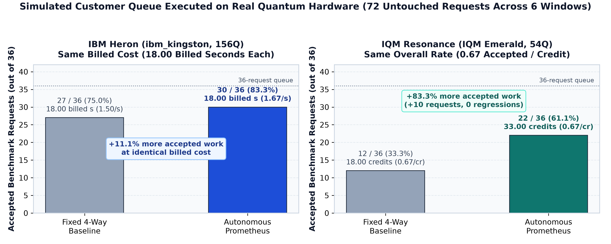
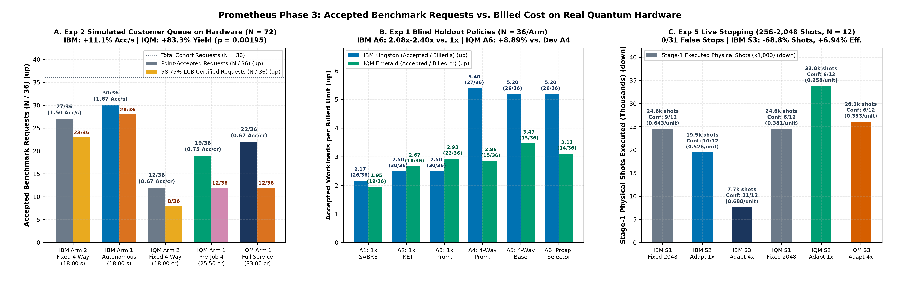
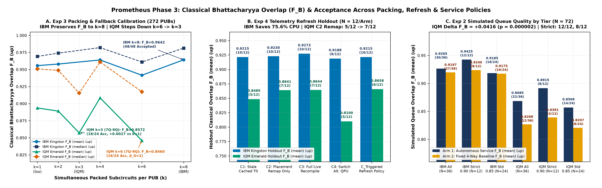
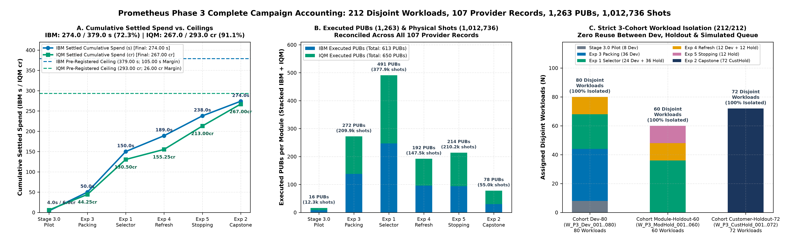
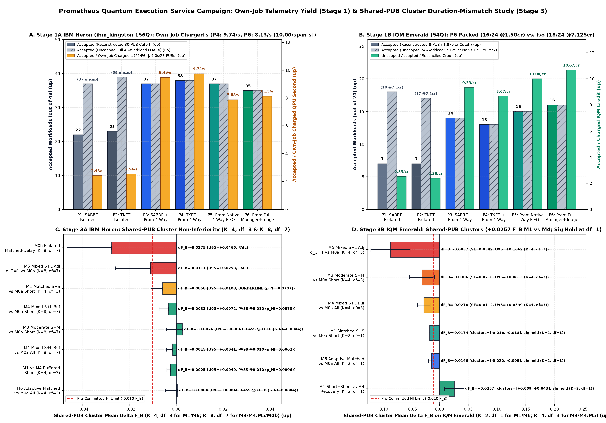
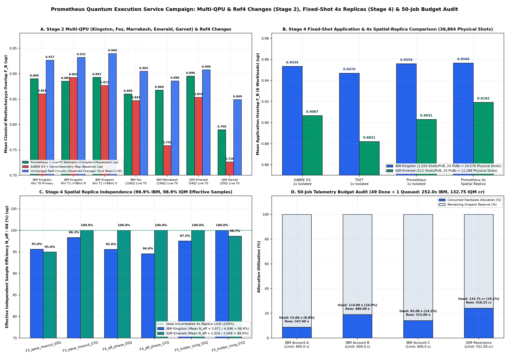
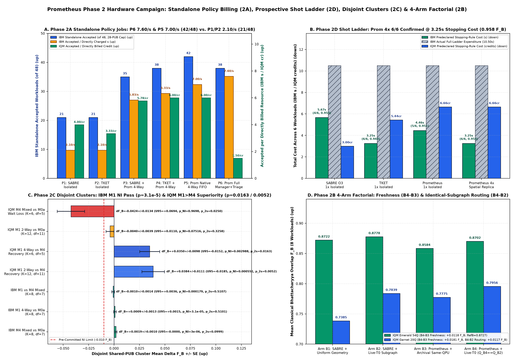

# Prometheus Quantum Execution Service: Autonomous Scheduling & Execution Management on Cloud Quantum Hardware

**308 Disjoint Unseen Workloads | 157 Provider Job Records | 2,509 Executed PUBs | 2,093,568 Physical Shots Across 5 Physical QPUs (`ibm_kingston`, `ibm_fez`, `ibm_marrakesh`, `IQM Emerald`, `IQM Garnet`)**

---

## More Accepted Work from an Adaptive Quantum Execution Service

### The Customer Problem
When quantum users submit a queue of workloads to cloud processors billed per QPU second (IBM Quantum) or per credit (IQM Resonance), fixed execution policies leave value on the table. Running circuits in isolation wastes chip capacity; packing incompatible circuits together introduces crosstalk or idle-wait decoherence; recompiling every cached circuit before every job wastes classical CPU time; and running a fixed 2,048-shot budget on every circuit overspends on easy requests that pass early.

### What Prometheus Does
**Prometheus helps quantum users get more useful results from the hardware they already have - by improving compilation, selecting suitable processors, running compatible workloads together, and stopping measurements when enough evidence has been collected.**

Prometheus combines its own hardware-aware compilation with execution management around **Qiskit SABRE** and **Quantinuum TKET**, evaluating candidate implementations and using workload structure and live hardware telemetry across **308 unseen benchmark workloads** (157 provider job records, 2,509 PUBs, 2,093,568 physical shots) to decide when to pack, isolate, remap, stop measurements early, or selectively retry.

### Three Key Results on Blind Holdouts
1. **More Accepted Requests from a Simulated Customer Queue on Real Hardware (`Experiment 2`, `Table 1`):** On IBM Heron (`ibm_kingston`), Prometheus completed **30/36** benchmark requests meeting predefined quality targets versus **27/36** with the fixed 4-way packing baseline, at the **exact same 18.00 provider-billed QPU seconds** (+11.11% accepted requests per billed second).
   *Supporting metrics:* On IQM Emerald (36 requests), Prometheus completed **22/36 vs. 12/36** (+83.33% accepted requests) while matching the baseline's overall credit efficiency (0.6667 accepted requests per IQM credit across 33.00 vs. 18.00 credits, and **+11.76%** higher per-credit efficiency before `Job 4` retries; `F_B = 0.8685` vs. 0.8268, request-level `p_Holm = 3.36 × 10⁻⁶`, `K = 12` PUB-cluster CRVE `p = 0.000012`); on IBM, **12/12 vs. 8/12** strict-category requests met their workload-specific acceptance criteria.
2. **Zero False Stops in Live Adaptive Shot Halting (`Experiment 5`, `Table 2`):** Across 31 adaptive early or terminal halts along a `256 -> 512 -> 1,024 -> 2,048` shot ladder, **every halt (31/31, 0.0% false-stop rate)** passed its independent 1,024-shot matched-policy confirmation job.
   *Supporting metrics:* On IBM Heron, 4-replica adaptive stopping used **68.75% fewer Stage-1 physical shots** (7,680 vs. 24,576) and **50.63% fewer active QPU execution seconds**, improving total (`Stage-1 + Confirm`) confirmed-accepted results per provider-billed second by **+6.94%** (11/12 vs. 9/12 confirmed).
3. **2.40x Higher Accepted-per-Billed-Second Efficiency in Prospective Policy Selection (`Experiments 1 & 4`, `Table 2`):** Across 36 unseen holdout workloads with separately billed arms on IBM Heron, the prospective selector achieved **5.20 accepted workloads per billed second**, a **2.40x** gain over isolated Qiskit SABRE (2.17 per billed second).
   *Supporting metrics:* On IQM Emerald (`Experiment 1`), the selector achieved **+8.89%** more accepted workloads per IQM credit than fixed 4-way packing (3.11 vs. 2.86 per credit) and `+0.03303 F_B` over packed SABRE (`p_Holm = 0.0096`); in `Experiment 4` (`Telemetry Refresh`), triggered refresh cut IBM classical CPU compilation time by **75.6%** (10/12 accepted), while fast IQM placement remapping (0.17 s CPU) raised accepted workloads from **5/12 to 7/12**.

### Service-Level Performance Overview

*Figure 0: Two-bar overview of accepted benchmark requests (`N = 36` per provider) in the `Experiment 2` simulated customer queue on real IBM Heron (18.00 provider-billed QPU seconds per arm) and IQM Emerald (33.00 vs. 18.00 IQM Resonance credits, identical 0.6667 accepted requests per credit). Detailed 3-panel module breakdowns follow in `Figure 1` below.*

### Practical Implications for Users and Providers
Saving measurements or recompiling circuits in isolation does not automatically save money; a useful execution service must coordinate classical compilation effort, packing density, provider billing floors (`billed seconds` vs. `active seconds` vs. `credits`), and sequential stopping together. All 157 provider records, 4,963 workload evaluations, and cluster-aware sensitivity checks in this repository can be audited offline via `python scripts/verify_execution_service_campaign.py`.

> [!NOTE]
> **How to Run the Offline Audit (1 Command, Zero Cloud Credentials Required):**
> Run `python scripts/verify_execution_service_campaign.py` (requires only Python standard library + `numpy` + `scipy`).
> The verifier performs a **15-stage consistency, arithmetic, cryptographic commitment, and statistical audit of the published outcome ledgers** across `manifests/` and `data/`. Because the public ledgers archive measured per-workload, per-subcircuit, and per-rung metrics (`fb_measured`, `fh_measured`, `tvd_measured`, `shannon_entropy_bits`, `observable_measured`) rather than raw 2^n bitstring histograms, the verifier checks `F_H = F_B²`, uniform-excess normalization, dual threshold pass/fail logic, job-level billing sums, pre-execution SHA-256 commitment chains, and independently recomputes all arm means, medians, accepted counts, adaptive stopping trajectories, non-inferiority bounds, paired Student-t tests, exact McNemar tests, and Holm-Bonferroni multiplicity adjustments from the stored per-workload/per-PUB records. See [`PUBLIC_DISCLOSURE.md`](PUBLIC_DISCLOSURE.md) and [`DATA_DICTIONARY.md`](DATA_DICTIONARY.md) for full details.

---

# Part I: Phase 3 Autonomous Quantum Execution Service Technical Reference (212 Disjoint Workloads, 107 Provider Records, 1,263 PUBs, 1,012,736 Physical Shots)

> [!IMPORTANT]
> **Executive Summary & Principal Service-Level Findings (`v3.1` Pre-Registered Campaign Across IBM Quantum `ibm_kingston` / `ibm_fez` and IQM Resonance `emerald` / `garnet`):**
> 1. **Integrated Simulated Customer-Queue Capstone Executed on Real Quantum Hardware (`Experiment 2`, `W_P3_CustHold_001..072`, 72 Untouched Benchmark Requests Across 6 Operating Windows):** Combining all four locked Phase 3 modules (hardware-calibrated packing-density fallback, prospective policy selection, triggered calibration refresh, and sequentially valid live stopping with an Upper-Confidence-Bound futility filter) without any tuning on `Cohort Customer-Queue-Holdout-72`:
>    - **IBM Quantum (`ibm_kingston`, 36 Requests, 12 Jobs = 6 per Arm):** `Service_Arm_1: Prometheus_Autonomous_Service` accepted **30/36 (83.3%)** requests (28/36 98.75%-LCB certified) versus **27/36 (75.0%)** (23/36 LCB certified) for `Service_Arm_2: Best_Dev_Selected_Fixed_Policy` (`A4_Fixed_4Way_Prometheus` on T_0) at the exact same settled cost (**18.00 s** vs. **18.00 s**), delivering **+11.11% higher point-accepted billing efficiency** (1.6667 vs. 1.5000 Acc/s) and **+21.74% higher LCB-certified billing efficiency** (1.5556 vs. 1.2778 Cert/s). All 12 requests in the strict-policy category (`Strict_FB_090` tier; workload-specific thresholds `τ_FB = 0.900` on `4Q` and 0.846 on `7Q`, plus observable thresholds) met their predefined workload-specific acceptance criteria (**12/12 [100.0%]**), versus 8 of 12 (66.7%) under fixed scheduling (`Service_Arm_2`).
>    - **IQM Resonance (`emerald`, 36 Requests, 15 Benchmark Jobs = 9 `Arm 1` + 6 `Arm 2`, plus 1 Station Warm-Up):** `Service_Arm_1` nearly doubled accepted benchmark requests from **12/36 (33.3%)** to **22/36 (61.1%)** (**+83.33% relative yield increase**, request-level exact two-sided McNemar p = 0.001953, Holm-adjusted p = 0.003906), retaining all 12 baseline successes and adding 10 more (`b10 = 10, b01 = 0`). Classical Bhattacharyya overlap F_B rose by **+0.04162** (0.8685 vs. 0.8268 *(mean)*; 0.9152 vs. 0.8912 *(median)*; request-level paired t_35 = 5.7460, p = 1.68 × 10⁻⁶, Holm-adjusted p = 3.36 × 10⁻⁶). In cluster-aware sensitivity checks accounting for shared packed PUBs and sub-wave jobs ([`Table 3B` in `phase3_exp2_customer_queue_service_report.md`](reports/phase3_exp2_customer_queue_service_report.md)), IQM gains remain statistically significant across all **`K = 12` PUB-disjoint clusters** (12/12 positive ΔF_B: CRVE t_11 = +7.4870, p = 0.000012, exact `2^12` sign-flip p = 0.000488; ΔAccepted CRVE t_11 = +3.1464, p = 0.009301, sign-flip p = 0.031250) and **`K = 6` sub-wave job-pair clusters** (6/6 positive ΔF_B: CRVE t_5 = +6.1438, p = 0.001660, sign-flip p = 0.031250; ΔAccepted CRVE t_5 = +3.3710, p = 0.019868), with 3/3 operating windows positive (`K = 3`: CRVE t_2 = +4.7854, p = 0.041000 on ΔF_B; t_2 = +5.0000, p = 0.037750 on ΔAccepted). Before selective `Job 4` retries (`SubWave_A + SubWave_B` only, 25.50 cr), `Service_Arm_1` accepted 19/36 requests (0.7451 Acc/cr, **+11.76%** above `Service_Arm_2`'s 0.6667 Acc/cr); including `Job 4` (33.00 cr total), `Service_Arm_1` matched `Service_Arm_2`'s exact overall billing efficiency (**0.6667 Acc/cr**) while delivering **1.83x (22 vs. 12)** the accepted requests.
> 2. **Module-Level Blind Holdout Advances (`Stage 3.0`, `Exp 3`, `Exp 1`, `Exp 4`, `Exp 5`):**
>    - **Packing-Density Calibration (`Exp 3`, `W_P3_Dev_009..044`, 272 PUBs):** IBM 8-way packing preserved overlap (0.9642 *(mean)* vs. 0.9627 matched `k=1` controls, 48/48 accepted); IQM 4-way packing achieved 0.9085 *(mean)* (35/48 accepted on `4Q-7Q` subset `SC_1, SC_2, SC_5`), while 6-way packing on `7Q-9Q` subset `SC_3, SC_4` forced `d_G = 1` (0.846034 [0.8460] *(mean)* / 0.9174 *(median)*, 16/24 accepted, -0.00840 vs. matched `k=1` 0.854432) and stepped down to 3-way fallback (0.857180 [0.8572] *(mean)* / 0.9155 *(median)*, 18/24 accepted, +0.002748 vs. matched `k=1`).
>    - **Separately Billed Prospective Policy Selector (`Exp 1`, `W_P3_ModHold_001..036`, 36 Unseen Workloads/Arm):** On IBM, `A6_Prospective_Selector` achieved **5.20 Acc/s**, **2.40x** (+140.0%) above isolated SABRE (2.17 Acc/s) and **2.08x** (+108.0%) above isolated TKET (2.50 Acc/s). On IQM, `A6_Prospective_Selector` achieved **3.11 Acc/cr**, **+8.89%** above the Dev-selected fixed baseline (`A4_Fixed_4Way_Prometheus`, 2.86 Acc/cr), with within-group overlap gains of **+0.03303** over packed SABRE (`A5`, 0.8436 vs. 0.8105, `p = 0.0032`, Holm-adjusted `p = 0.0096`) and **+0.01615** over `A4` (0.8436 vs. 0.8274, `p = 0.0314`, Holm-adjusted `p = 0.0627`).
>    - **Telemetry Refresh Policy (`Exp 4`, `W_P3_ModHold_037..048`, 192 PUBs):** On IBM, `C_Triggered_Refresh_Policy` retained cached T_0 circuits (10/12 accepted, `F_B = 0.9215` *(mean)* / 0.9236 *(median)*), reducing live CPU compilation effort by **-75.6%** versus full recompilation (`C3`). On IQM, placement-only refresh (`C2`) raised accepted workloads from 5/12 to 7/12 and mean F_B from 0.8485 to 0.8641, while `C_Triggered_Refresh_Policy` achieved the highest mean overlap (0.8658).
>    - **Sequentially Valid Live Stopping (`Exp 5`, `W_P3_ModHold_049..060`, 214 PUBs):** Across 48 adaptive 4-rung trajectories (**`256 -> 512 -> 1,024 -> 2,048` physical shots per PUB**, plus independent 1,024-shot confirmation), **0/31 early or terminal halts failed their independent 1,024-shot matched-policy confirmation job (`0.0% <= 5.0%`)**. On IBM, `S3_Adaptive_4x` reduced Stage-1 physical shots by **-68.75%** (7,680 vs. 24,576) and active QPU time by **-50.63%** (5.8106 s vs. 11.7692 s), raised confirmed yield from 9/12 (75.0%) to **11/12 (91.7%)**, and improved total (`Stage-1 + Confirm`) billing efficiency by **+6.94%** (0.6875 vs. 0.6429 Conf. Acc/s).
> 3. **Complete Campaign Accounting (212/212 Disjoint Workloads Within Both Spending Ceilings):** Across all 6 Phase 3 modules, Prometheus executed **107 provider records** (99 benchmark jobs + 4 scheduled warm-ups + 4 troubleshooting records), **1,263 PUBs** (613 IBM + 650 IQM), and **1,012,736 actual executed physical shots** (620,032 IBM + 392,704 IQM), settling at **`274.00 s / 379.00 s`** on IBM Quantum (105.00 s unused reserve) and **`267.00 cr / 293.00 cr`** on IQM Resonance (26.00 cr unused reserve).

---

## 1. Principal Phase 3 Comparative Benchmark Tables

### Table 1: Capstone Simulated Customer-Queue Benchmark Executed on Real Quantum Hardware (`Experiment 2`, `W_P3_CustHold_001..072`, `N = 36` Benchmark Requests Across 3 Windows per Provider)

*Metric Conventions:* Classical Bhattacharyya distribution overlap is F_B = Σ_x √(P_ideal(x) · P_meas(x)) (labeled `"State Fidelity"` in Studio UI screenshots), and Squared Hellinger fidelity is F_H = F_B². Direction indicators `(↑)` and `(↓)` denote whether higher or lower values are better; winning values in each provider block are **bolded**. Job-level billing ratios (`Point Acc / Billed Unit`, `LCB Cert / Billed Unit`) are descriptive ratios of total accepted requests to total settled provider billing and are reported separately from the paired workload-level statistical hypothesis tests (N = 36) in Table 2.

| Provider & QPU | Service Policy Arm | Hardware Job IDs (`N` Jobs) | PUBs (`N`) | Physical Shots (↓) | Active QPU Time `s` (↓) | Settled Billed Cost (↓) | 2Q Gates `*(mean / median)*` (↓) | Compiled Depth `*(mean / median)*` (↓) | Overlap F_B `*(mean / median)*` (↑) | Hellinger F_H = F_B² `*(mean / median)*` (↑) | TVD `*(mean / median)*` (↓) | Shannon Entropy `bits` `*(mean / median)*` | Point Accepted Requests (↑) | LCB-Certified Requests (↑) | Point Acc / Billed Unit (↑) | LCB Cert / Billed Unit (↑) | % Delta Point Acc / Billed vs. `Arm 2` (↑) |
| :--- | :--- | :--- | :---: | :---: | :---: | :---: | :---: | :---: | :---: | :---: | :---: | :---: | :---: | :---: | :---: | :---: | :---: |
| **IBM Quantum** (`ibm_kingston`, 156Q) | **`Service_Arm_1: Prometheus_Autonomous_Service`** | 6 (`dbpfvelt7fqc7389c7o0`, `dbpfvloqtr0c738ebrl0`, `dbpfvt44148s739ui54g`, `dbpg038ou4as73ctjr60`, `dbpg0hlt7fqc7389c99g`, `dbpg0p8ou4as73ctjs1g`) | 18 | 18,432 | 10.5353 s | **18.00 s** | **61.89** / 40.5 | 131.06 / 98.5 | **0.9265** / **0.9572** | **0.8653** / **0.9162** | **0.2090** / **0.1590** | 3.0242 / 2.4352 | **30 / 36 (83.3%)** | **28 / 36 (77.8%)** | **1.6667 Acc/s** | **1.5556 Cert/s** | **+11.11%** (+21.74% LCB) |
| **IBM Quantum** (`ibm_kingston`, 156Q) | `Service_Arm_2: Best_Dev_Selected_Fixed_Policy` (`A4_Fixed_4Way`) | 6 (`dbpfuvk4148s739ui3l0`, `dbpfvhoou4as73ctjqbg`, `dbpfvpdt7fqc7389c8c0`, `dbpg00tt7fqc7389c8kg`, `dbpg0dlt7fqc7389c930`, `dbpg0lgqtr0c738ebsqg`) | **12** | **12,288** | **8.9266 s** | **18.00 s** | 63.58 / **40.0** | **121.33** / **86.5** | 0.9197 / 0.9534 | 0.8520 / 0.9089 | 0.2240 / 0.1805 | 3.0552 / 2.7429 | 27 / 36 (75.0%) | 23 / 36 (63.9%) | 1.5000 Acc/s | 1.2778 Cert/s | 0.00% *(Baseline)* |
| **IQM Resonance** (`emerald`, 54Q) | **`Service_Arm_1: Prometheus_Autonomous_Service`** *(Pre-Job 4: SubWave A+B Only)* | 6 (`01a1c53c-d0c1-7201-b23b-fa5d77e2b77d`, `01a1c53f-381b-75e8-b285-0bfb2c12679b`, `01a1c543-5c7c-71f8-ab2e-d717ed252327`, `01a1c544-142e-72ad-8c9e-911eb5f8691d`, `01a1c545-ad0e-7681-b4a5-2c4bd37cb39e`, `01a1c546-4d8d-7425-b57f-ff64698496e0`) | 24 | 12,288 | 34.0000 s | 25.50 cr | **58.42** / **34.5** | **98.72** / 82.0 | 0.8648 / 0.9105 | 0.7662 / 0.8290 | 0.3194 / 0.2812 | 3.5380 / 3.4102 | 19 / 36 (52.8%) | **12 / 36 (33.3%)** | **0.7451 Acc/cr** | 0.4706 Cert/cr | **+11.76%** (+58.33% Acc Yield) |
| **IQM Resonance** (`emerald`, 54Q) | **`Service_Arm_1: Prometheus_Autonomous_Service`** *(Full: Incl. Selective Job 4)* | 9 (6 SubWave jobs above + 3 `Job 4` retry jobs: `01a1c542-d212-7144-bbe0-ef916005fcb9`, `01a1c544-5833-7649-bbcb-33e340d17ce4`, `01a1c546-d98d-7777-89e2-cacafd2a6727`) | 35 | 17,920 | 44.0000 s | 33.00 cr | **58.42** / **34.5** | **98.72** / 82.0 | **0.8685** / **0.9152** | **0.7721** / **0.8377** | **0.3122** / **0.2701** | 3.5218 / 3.3837 | **22 / 36 (61.1%)** | **12 / 36 (33.3%)** | 0.6667 Acc/cr | 0.3636 Cert/cr | 0.00% (**+83.33% Acc Yield**) |
| **IQM Resonance** (`emerald`, 54Q) | `Service_Arm_2: Best_Dev_Selected_Fixed_Policy` (`A4_Fixed_4Way`) | 6 (`01a1c539-e6bc-706a-a57c-f8e4758c2fb8`, `01a1c53d-170d-75ed-a369-9dc7fc6b6063`, `01a1c543-34a9-7573-823a-125b0e7655be`, `01a1c543-e4e5-7367-b37f-9e5ac1c9c9e6`, `01a1c544-91c7-7715-8ae7-7d2d1fa7a228`, `01a1c545-f4e8-7464-ac4a-e48e852c9e71`) | **12** | **6,144** | **24.0000 s** | **18.00 cr** | 61.25 / 41.0 | 103.03 / **74.0** | 0.8268 / 0.8912 | 0.7074 / 0.7942 | 0.3861 / 0.3353 | 3.8120 / 3.9332 | 12 / 36 (33.3%) | 8 / 36 (22.2%) | 0.6667 Acc/cr | 0.4444 Cert/cr | 0.00% *(Baseline)* |

---

### Table 2: Cross-Module Blind Holdout Summary Across All Phase 3 Experiments (212 Disjoint Workloads)

| Phase 3 Module & Holdout Cohort | Primary Comparison (`Autonomous Policy` vs. `Baseline`) | IBM Quantum (`ibm_kingston`) Key Holdout Outcome | IQM Resonance (`emerald`) Key Holdout Outcome | Paired Statistical Evidence (`Unadjusted` / `Holm-Adjusted`) |
| :--- | :--- | :--- | :--- | :--- |
| **Stage 3.0: Measured-Cost Pilot** (`W_P3_Dev_001..008`, 2 jobs, 16 PUBs, 12,288 shots) | `k=4` Packed vs. `k=1` Isolated Billing & Overlap | 4/4 accepted (`F_B = 0.9462` *(mean)* / 0.9585 *(median)*; 4.00 s settled) | 3/4 accepted (`F_B = 0.8753` *(mean)* / 0.9036 *(median)*; 6.00 cr settled) | Calibrated `InFlightAllowanceReservationGuard` cost model |
| **Exp 3: Packing-Density & Fallback Calibration** (`W_P3_Dev_009..044`, 8 jobs, 272 PUBs, 209,920 shots) | `k in {2,3,4,6,8}` vs. Matched-Subgraph `k=1` Controls | **`k=8` `F_B = 0.9642` *(mean)* (48/48 accepted**, +0.00154 vs. matched `k=1` 0.9627) | **`k=4` (`4Q-7Q`): `F_B = 0.9085` *(mean)* (35/48 accepted)**; `k=6` (`7Q-9Q`, `d_G=1`): `F_B = 0.846034` (16/24) stepped down to **`k=3`: `F_B = 0.857180` (18/24 accepted, +0.00275 vs. `k=1`)** | Locked `phase3_locked_packing_fallback_rule.json` (`d_G >= 2` + duration split) |
| **Exp 1: Prospective Policy Selector** (`W_P3_ModHold_001..036`, 26 bench jobs, 491 PUBs, 377,856 shots) | `A6_Prospective_Selector` vs. Separately Billed `A1..A5` | **5.20 Acc/s (26/36 acc / 5.00 s)**, **2.40x** vs. `A1_SABRE` (2.17 Acc/s) & **2.08x** vs. `A2_TKET` (2.50 Acc/s) | **3.11 Acc/cr (14/36 acc / 4.50 cr)**, **+8.89%** vs. Dev-selected `A4` (2.86 Acc/cr); `A3_Prometheus_1x` 22/36 acc | IQM `A6` vs. `A5_SABRE` Δ F_B = +0.03303 (`p = 0.0032`, **Holm `p = 0.0096`**); vs. `A4` Δ F_B = +0.01615 (`p = 0.0314`, Holm `p = 0.0627`) |
| **Exp 4: Telemetry Refresh Policy** (`W_P3_ModHold_037..048`, 12 jobs, 192 PUBs, 147,456 shots) | `C_Triggered_Refresh_Policy` vs. `C1_Stale`, `C2_Remap`, `C3_Fresh`, `C4_Switch` | Retained 12/12 cached T_0 circuits (**10/12 accepted**, `F_B = 0.9215` *(mean)* / 0.9236 *(median)*), cutting live CPU time by **-75.6%** vs. `C3` | `C2_Placement_Remap` raised yield **`5/12 -> 7/12`** (`F_B: 0.8485 -> 0.8641`); `C_Triggered` reached **`F_B = 0.8658`** (6/12 acc) | Demonstrated selective `C1/C2/C3` refresh without blind recompilation |
| **Exp 5: Sequentially Valid Live Stopping** (`W_P3_ModHold_049..060`, 24 bench jobs, 214 PUBs, 210,176 shots) | `S2_Adaptive_1x` & `S3_Adaptive_4x` (256..2,048 shots) vs. `S1_Fixed_2048` + 1,024 Confirm | **`S3_Adaptive_4x`: -68.75% Stage-1 shots** (7,680 vs. 24,576), **-50.63% active QPU `s`**, **11/12 vs. 9/12 confirmed**, **+6.94% total `Conf. Acc/s`** | `S3_Adaptive_4x`: -43.33% Stage-1 shots vs. 46,080 max (26,112 vs. 24,576 `S1`), -10.88% active QPU `s`, 6/12 confirmed yield across `S1/S2/S3` | **0/31 unconfirmed false stops (`0.0% <= 5.0%`)**; IBM `S3` vs. `S1` Stage-1 Δ F_B = +0.0129 (0.9355 vs. 0.9226), Confirm Δ F_B = +0.0269 |
| **Exp 2: Simulated Customer Queue Capstone** (`W_P3_CustHold_001..072`, 27 bench jobs, 78 PUBs, 55,040 shots) | `Service_Arm_1: Autonomous_Service` vs. `Service_Arm_2: Fixed_4Way_Baseline` | **30/36 (83.3%) vs. 27/36 (75.0%) accepted** at identical **18.00 s** (**+11.11% Acc/s**, **`+21.74% LCB Cert/s`**; 12/12 vs. 8/12 in strict-policy category) | **22/36 (61.1%) vs. 12/36 (33.3%) accepted** (**+83.33% yield**; +11.76% Acc/cr pre-`Job 4`, 0.00% penalty full) | IQM Δ F_B = +0.04162 (`N=36` `p = 1.68e-6` / Holm `3.36e-6`; **`K=12` PUB-cluster CRVE `p = 0.000012`, `K=6` sub-wave `p = 0.00166`**); McNemar `(10, 0)` `p = 0.00195` (**`K=12` CRVE `p = 0.00930`, `K=6` `p = 0.01987`**) |

---

### Table 3: Cumulative 3-Phase Campaign Accounting (`Phase 1` + `Phase 2` + `Phase 3`)

| Campaign Phase | Unseen Workloads (`N`) | Provider Records (`Bench + Aux`) | Physical PUBs (`N`) | Physical Shots (`N`) | Settled Spend (`IBM s` / `IQM cr`) | Detailed Reports |
| :--- | :---: | :---: | :---: | :---: | :---: | :--- |
| **Phase 3: Autonomous Service & Capstone (`v3.1`)** | **212** (`Dev-80`, `ModHold-60`, `CustHold-72`) | **107** (99 bench + 4 warm-up + 4 troubleshoot) | **1,263** (613 IBM + 650 IQM) | **1,012,736** (620,032 IBM + 392,704 IQM) | **274.00 s** (`/ 379.00 s`) / **267.00 cr** (`/ 293.00 cr`) | [Capstone](reports/prometheus_phase3_capstone_evidence_release.md), [Exp 1/3](reports/phase3_exp1_autonomous_selector_report.md), [Exp 4](reports/phase3_exp4_telemetry_refresh_report.md), [Exp 5](reports/phase3_exp5_live_stopping_report.md), [Exp 2](reports/phase3_exp2_customer_queue_service_report.md) |
| **Phase 2: Standalone Billing, Shot Ladder & Clusters** | **96** (48 Core + 48 Extended) | **28** (28 bench, 0 aux) | **629** (335 IBM + 294 IQM) | **542,720** (336,896 IBM + 205,824 IQM) | **141.00 s** (`/ 175.00 s`) / **85.50 cr** (`vs. 84.00 cr`) | [Phase 1+2 Report](reports/prometheus_phase1_phase2_campaign_report.md), `data/phase2*.json` |
| **Phase 1: Multi-QPU Routing, Replicas & Failover** | **48** Core (`W01..W48`) | **22** (22 bench, 0 aux) | **617** (457 IBM + 160 IQM) | **538,112** (456,192 IBM + 81,920 IQM) | **129.00 s** / **47.25 cr** | [Phase 1+2 Report](reports/prometheus_phase1_phase2_campaign_report.md), `data/stage*.json` |
| **GRAND CUMULATIVE TOTALS** | **308 Disjoint Workloads** | **157 Records (149 Bench + 8 Aux)** | **2,509 PUBs** | **2,093,568 Shots** | **544.00 s IBM / 399.75 cr IQM** | [`scripts/verify_execution_service_campaign.py`](scripts/verify_execution_service_campaign.py) |

---

## 2. Publication-Grade Phase 3 Evidence Figures (`300 DPI`)

### Figure 1: Accepted Requests vs. Billed Cost Across Operating Policies (`Exp 2`, `Exp 1`, and `Exp 5`)

---

### Figure 2: Output Quality (F_B) & Acceptance vs. Execution Policy (`Exp 3`, `Exp 4`, and `Exp 2`)

---

### Figure 3: Complete Phase 3 Campaign Accounting & Disjoint Cohort Isolation (212 Workloads, 107 Records, 1,263 PUBs, 1,012,736 Shots)

---

## 3. Complete Phase 3 Campaign Accounting & Cryptographic Ledger Inventory

### Table 3: End-to-End Phase 3 Hardware Execution & Allowance Reconciliation (`Stage 3.0` through `Experiment 2`)

| Phase 3 Stage / Experiment | Assigned Disjoint Cohort (`N` Workloads) | Benchmark Jobs (`IBM` + `IQM`) | Aux / Warm-Up / Troubleshoot Records | Total Provider Records | PUBs Executed (`IBM` + `IQM` = Total) | Actual Executed Physical Shots (`IBM` + `IQM` = Total) | IBM Settled Spend (`s`) | IQM Settled Spend (`cr`) | Status |
| :--- | :--- | :---: | :---: | :---: | :---: | :---: | :---: | :---: | :---: |
| **Stage 3.0: Measured-Cost Pilot** | `W_P3_Dev_001..008` (8) | 2 (`1 + 1`) | 0 | 2 | `8 + 8 = 16` | `8,192 + 4,096 = 12,288` | 4.00 s | 6.00 cr | **Completed** |
| **Priority 1 - Exp 3: Packing Calibration** | `W_P3_Dev_009..044` (36) | 8 (`4 + 4`) | 0 | 8 | `138 + 134 = 272` | `141,312 + 68,608 = 209,920` | 46.00 s | 38.25 cr | **Completed** |
| **Priority 2 - Exp 1: Policy Selector** | `W_P3_Dev_045..068` + `W_P3_ModHold_001..036` (60) | 26 (`14 + 12`) | 2 warm-ups + 4 troubleshoot | 32 | `247 + 244 = 491` | `252,928 + 124,928 = 377,856` | 100.00 s | 86.25 cr | **Completed** |
| **Priority 3 - Exp 4: Telemetry Refresh** | `W_P3_Dev_069..080` + `W_P3_ModHold_037..048` (24) | 12 (`6 + 6`) | 0 | 12 | `96 + 96 = 192` | `98,304 + 49,152 = 147,456` | 39.00 s | 24.75 cr | **Completed** |
| **Priority 4 - Exp 5: Live Stopping** | `W_P3_ModHold_049..060` (12) | 24 (`12 + 12`) | 1 IQM station warm-up (1 PUB) | 25 | `94 + 120 = 214` | `88,576 + 121,600 = 210,176` | 49.00 s | 57.75 cr | **Completed** |
| **Priority 5 - Exp 2: Customer Queue Capstone** | `W_P3_CustHold_001..072` (72) | 27 (`12 + 15`) | 1 IQM station warm-up (1 PUB) | 28 | `30 + 48 = 78` | `30,720 + 24,320 = 55,040` | 36.00 s | 54.00 cr | **Completed** |
| **Grand Cumulative Phase 3 Campaign Totals** | **212 / 212 Disjoint Workloads** | **99 (`49 + 50`)** | **4 warm-ups + 4 troubleshoot** | **107 (`49 IBM + 58 IQM`)** | **`613 + 650 = 1,263` PUBs** | **`620,032 + 392,704 = 1,012,736` Shots** | **274.00 s / 379.00 s** (105.00 s left) | **267.00 cr / 293.00 cr** (26.00 cr left) | **100% Complete** |

---

### Table 4: Sanitized Public Evidence Release Archive Inventory (`prometheus_phase3_autonomous_service_evidence_release.zip`)

| Archive Path | Description & Role in Phase 3 Campaign | Exact File `SHA-256` Checksum |
| :--- | :--- | :--- |
| `manifests/phase3_submission_manifest_v3.json` | Pre-registered 212-workload cohort assignment & budget ceiling manifest (`v3.1`) | `86968d1471af9228dd1902b0266569ac95b143e237027718cffaa383ab03cfba` |
| `manifests/phase3_amendment_log_v3_1.json` | Dated pre-holdout amendment log (`AMEND-P3-001` through `AMEND-P3-003`) | `d2303277634adb9e1433d6f7a9e34f60d8cb7d6ad37ba1c6b5de1baeab08e692` |
| `data/phase3_locked_packing_fallback_rule.json` | Locked Experiment 3 packing-density (`k`) & buffer (`d_G`) fallback rule | `6889585fae19e99954661ebd75564489070f1dcaa890f418a5818693479a79c8` |
| `data/phase3_locked_policy_selector.json` | Locked Experiment 1 prospective compiler & packing policy selector | `77bb8ac25c55af34993edcdd1335f76f64e65de157e478f5700bf40c22cdb14b` |
| `data/phase3_locked_refresh_policy.json` | Locked Experiment 4 triggered calibration refresh policy (`C_Triggered`) | `c8fa9126a5daa6304160e82e3b800db586e0a92ed327fb9cc7395803563ad5b0` |
| `data/phase3_exp5_preexecution_frozen_plan.json` | Pre-execution frozen compiled plan for Experiment 5 (`W_P3_ModHold_049..060`) | `236d28a63a879c421fd3f6e79dcb08577fbd4004b394453643414673cd0dc584` |
| `data/phase3_exp5_live_stopping_results.json` | Complete Experiment 5 live stopping & confirmation ledger (25 records) | `5174359a652e8efd7b1d4af221a303120ef48dfdd54eec337c6c32aec7912b07` |
| `data/phase3_exp2_preexecution_frozen_plan.json` | Pre-execution frozen customer-queue plan for Experiment 2 (`W_P3_CustHold_001..072`) | `763c6b7311aadc9ddca5cb8becb4025c80425c9e4d861381270a9f3c36e67a8c` |
| `data/phase3_exp2_customer_queue_results.json` | Complete Experiment 2 customer-queue service capstone ledger (28 records) | `a4d68304e393e0fd23960d8d11dad20fa163b0aaf5497bb32cb0508c761dc201` |
| `data/phase3_allowance_reservation_ledger.json` | Cumulative Phase 3 hardware allowance & job settlement ledger (274.00 s / 267.00 cr) | `bd5db45101a84bfa6bc1001926f9a71e9d30ebc7a3a80c0cbce8569035847dc1` |
| `assets/fig0_service_two_bar_overview.png` | Figure 0: Two-bar customer-queue service overview (`Exp 2`, IBM & IQM) | Included in release archive (`300 DPI`) |
| `assets/fig1_phase3_accepted_requests_vs_billed_cost.png` | Figure 1: Accepted requests vs. billed hardware cost (`Exp 2`, `Exp 1`, `Exp 5`) | Included in release archive (`300 DPI`) |
| `assets/fig2_phase3_quality_vs_execution_policy.png` | Figure 2: Classical overlap F_B vs. execution policy (`Exp 3`, `Exp 4`, `Exp 2`) | Included in release archive (`300 DPI`) |
| `assets/fig3_phase3_complete_campaign_accounting.png` | Figure 3: Complete campaign accounting (212 workloads, 1,263 PUBs, 1,012,736 shots) | Included in release archive (`300 DPI`) |
| `reports/phase3_exp1_autonomous_selector_report.md` | Detailed Experiment 1 & Experiment 3 benchmark report | Included in release archive |
| `reports/phase3_exp4_telemetry_refresh_report.md` | Detailed Experiment 4 stale calibration & refresh report | Included in release archive |
| `reports/phase3_exp5_live_stopping_report.md` | Detailed Experiment 5 sequentially valid live stopping report | Included in release archive |
| `reports/phase3_exp2_customer_queue_service_report.md` | Detailed Experiment 2 customer-queue capstone report | Included in release archive |

---

# Part II: Phase 1 & Phase 2 Dual-Provider Hardware Validation Technical Reference (96 Unseen Workloads, 50 Completed Jobs, 1,246 PUBs, 1,080,832 Physical Shots)

## Overview: What Prometheus Does, Three Practical Findings & How to Audit This Archive

- **What Prometheus Does:** Prometheus is a quantum execution-service and compilation layer that operates alongside standard quantum compilers (**Qiskit SABRE**, **Quantinuum TKET**, or Prometheus native synthesis). Given an incoming queue of user circuits and a hardware budget or submission cap, Prometheus packs compatible circuits onto disjoint buffered subgraphs within shared hardware `PUBs`, matches circuit durations on processors with global measurement barriers, routes circuits using live calibration telemetry, and pools shots across spatial replicas.
- **Three Principal Practical Findings (50 Completed Jobs, 1,246 Completed PUBs, 1,080,832 Completed Physical Shots across 5 QPUs):**
  1. **Higher Queue Productivity Alongside SABRE & TKET with Separately Billed Jobs (`Phase 2A`, `Table 6A`):** Under a 28-PUB submission cap on IBM Heron (`ibm_kingston`), standalone isolated `SABRE` (`P1`) and isolated `TKET` (`P2`) each deliver 21/48 accepted workloads in 10.0 s of billed QPU time (2.10 accepted workloads/s). Adding Prometheus spatial packing increases accepted workloads from 21 to 35-42 while reducing billed time to 5.0-6.0 s: **`SABRE + Prometheus` (`P3`)** delivers 35/48 in 6.0 s (**2.78x accepted workloads/s**), **`TKET + Prometheus` (`P4`)** delivers 38/48 in 6.0 s (**3.02x**), **`Prometheus Native Fixed Pack` (`P5`)** delivers **42/48 (87.5% queue yield)** in 6.0 s (**3.33x**), and **`Prometheus Full Manager` (`P6`)** delivers 38/48 in 5.0 s (**3.62x**). On IQM Emerald under an 8-PUB cap, **`TKET + Prometheus` (`P4`)** and **`Prometheus Native Fixed Pack` (`P5`)** each deliver 9/24 accepted workloads for 1.50 credits (6.00 acc/cr), achieving **+80% more accepted results for the same measured credit spend** as isolated `TKET` (5/24 at 1.50 credits).
  2. **Hardware-Specific Duration Matching Across Disjoint Shared-PUB Clusters (`Phase 1 Stage 3` & `Phase 2C`, `Table 6C`):** On IQM Emerald, where Station Control enforces a global measurement barrier across packed subcircuits, 4-way short-workload duration matching (`M1_4Way`) improves mean overlap by **+0.03497 F_B (p = 0.0163, K = 6, df = 5)** over mixed-duration packing (`M4_Mixed`), and 2-way duration matching (`M1_2Way`) improves overlap by **+0.03839 F_B (p = 0.0052, K = 12, df = 11)**, while formal non-inferiority to isolated execution (`M0a`) at the Δ_NI = 0.010 margin is not established on IQM (U_95% = +0.0187). On IBM Heron (`ibm_kingston`), 4-way short-workload packing (`M1_4Way`) is certified non-inferior to isolated `M0a` across K = 8 disjoint clusters (U_95% = +0.0015 ≪ 0.010, p_NI = 3.1 × 10⁻⁵, df = 7).
  3. **Prospective Shot-Ladder Convergence & 4x Spatial Replicas (`Phase 1 Stage 4` & `Phase 2D`, `Table 6B`):** Across the 4-rung shot ladder (256, 512, 1024, 2048 shots) plus independent out-of-sample confirmation (1,024 shots), **`Prometheus 4x Spatial Replica`** and **`TKET 1x`** confirm 6/6 workloads on IBM Heron at a **3.2500 s reconstructed stopping-rule cost** (10.5000 s actual full-ladder spend) versus 4/6 confirmed at 5.6667 s stopping cost for `SABRE 1x`, with `Prometheus 4x Spatial Replica` achieving the highest out-of-sample confirmed overlap (**0.957599 F_B *(mean)* / 0.989418 F_B *(median)*** on IBM; **0.916787 F_B *(mean)*** on IQM).
- **How to Audit This Archive Offline (1 Command):**
  Run `python scripts/verify_execution_service_campaign.py` (requires only Python standard library + `numpy` + `scipy`, zero cloud credentials). The public ledgers archive the per-workload/per-rung measured hardware outcomes (`fb_measured`, `fh_measured`, `tvd_measured`, `observable_measured`), cluster specifications, and job billing telemetries across all 50 completed hardware jobs (1,246 PUBs, 1,080,832 shots). From those stored per-workload records (without reading pre-aggregated summary tables), the verifier independently recomputes from scratch: (i) all 1,672 per-workload and per-rung evaluations (1,432 full per-workload records across the 10 stage/module ledgers + 240 Phase 2D shot-ladder rung records; distinct from the 50 completed jobs, 1,246 physical PUBs, and 1,080,832 physical shots), including Hellinger fidelities (F_H = F_B²), uniform-random normalized excess scores, threshold checks, and dual acceptance decisions; (ii) all 24 policy evaluations across `Phase 1 Stage 1A/1B` (`Table 1C`, 12 cutoff/uncapped policies) and `Phase 2A` (`Table 6A`, 12 standalone policies) including dual-criteria accepted counts, conditional/unconditional F_B means and medians, and billing-efficiency ratios; (iii) all 48 `Phase 2D` workload-method stopping-rung selections, cumulative stopping shots, reconstructed stopping-rule costs vs. actual full-ladder expenditures, and confirmation medians (`Table 6B`); (iv) all 27 shared-PUB cluster Student-t tests across `Phase 1 Stage 3A` (`Table 2A`, 10 IBM tests), `Phase 1 Stage 3B` (`Table 2B`, 9 IQM tests), and `Phase 2C` (`Table 6C`, 8 disjoint cluster tests) via `scipy.stats.t`; (v) all `Phase 2B` 4-arm factorial Student-t contrasts and matching recorded subgraph commitment hashes (`Table 6D`); and (vi) all `Phase 1 Stage 4` 4x spatial-replica effective independent sample sizes (N_eff).

---

## 1. Executive Summary & Principal Comparative Benchmark Tables

This report documents the telemetry-reconciled live hardware execution of **Phase 1 (22 completed jobs, 617 PUBs, 538,112 physical shots)** and **Phase 2 (28 completed jobs, 629 PUBs, 542,720 physical shots)** of the **Prometheus Quantum Execution Service & Temporal Drift Campaign** ([`prometheus_next_gen_execution_service_and_drift_plan.md`](PUBLIC_DISCLOSURE.md)), totaling **50 completed live QPU jobs (100% `DONE`), 1,246 completed PUBs, and 1,080,832 completed physical shots** across **IBM Quantum Heron (`ibm_kingston`, `ibm_fez`, `ibm_marrakesh` 156Q)** and **IQM Resonance (`emerald` 54Q & `garnet` 20Q)** ([`campaign_master_reconciliation.json`](data/campaign_master_reconciliation.json)).

### Pre-Execution Cryptographic Manifest Provenance
All 96 unseen logical workloads (48 Core + 48 Extended across 6 circuit families and widths `5Q, 7Q, 9Q, 11Q`) were generated and frozen prior to live hardware submission in [`manifests/unseen_workload_queue_48_core_96_ext.json`](manifests/unseen_workload_queue_48_core_96_ext.json) (111,422 bytes), verified in [`manifests/FROZEN_MANIFEST_SHA256SUMS.json`](manifests/FROZEN_MANIFEST_SHA256SUMS.json) (`SHA-256 = fd93334e7630dc38ab4231b6ab152a4adf702482190c124370bec9faf1720d1b`):
- **File SHA-256 (`manifests/unseen_workload_queue_48_core_96_ext.json`):** `8d7ba79f7249b52f269f3f09092a73855a697561f510953a2fa40f538e10771b`
- **Internal Canonical Payload SHA-256:** `e81b51ea82d21d1a18a68c99ac07232a77b4df20be9aae5b267bf1f73db1ef4a`

### Metric & Reporting Conventions
- **Classical Bhattacharyya Distribution Overlap (F_B):** F_B = Σ_x √(P_ideal(x) · P_meas(x)) (`(↑)` higher is better).
- **Squared Hellinger Fidelity (F_H):** F_H = F_B² (`(↑)` higher is better).
- **Total Variation Distance (TVD):** TVD = 0.5 · Σ_x |P_ideal(x) - P_meas(x)| (`(↓)` lower is better).
- **Dual Workload Acceptance Criteria (`accepted = int(fb_pass and observable_pass)):** Every workload in manifests/unseen_workload_queue_48_core_96_ext.json specifies both a pre-committed distribution overlap threshold (`fb_threshold`, e.g., 0.85 for 5Q Short, 0.82 for 7Q Short, 0.78 for 9Q Short, 0.75 for 11Q Short) and a family-specific application observable target (observable_target, e.g., QAOA MaxCut approximation ratio, QFT peak probability mass, or Trotter magnetization accuracy). A workload is counted as **accepted** if and only if it passes **both** criteria simultaneously.
- **Summary Statistics Convention:** Every cohort-level summary metric is explicitly labeled as `*(mean)*` or `*(median)*`. Winning values in each comparative row or column are **bolded**.

---

### Table 1A: Executive Summary Across Phase 1 (22 Completed Jobs) & Phase 2 (28 Completed Jobs = 50 Completed Jobs Total)

| Stage / Module & Scope | Hardware Backend(s) | Verifiable Provider Job IDs | Sample Size (`N` Jobs / PUBs / Physical Shots) | Primary Comparative Question | Winning Policy / Arm | Principal Empirical Outcome (`*(mean)*`, `*(median)*` & Exact Counts) | Telemetry-Verified Spend |
| :--- | :--- | :--- | :--- | :--- | :--- | :--- | :--- |
| **Phase 1 - Stage 0: Live Integration, Billing & Metadata Pilot** | IBM `ibm_kingston` (`156Q`) & IQM `emerald` (`54Q`) | IBM: `dbnj0igqtr0c73ad5pr0` (10 PUBs), `dbnj77dt7fqc73ajnupg` (3 PUBs) IQM: `01a1b67e-a782-76aa-9bf4-e10cacf2ab61` (4 PUBs), `01a1b67e-bf63-7167-a47a-7598abbbb4fb` (3 PUBs) | 4 Jobs / 20 PUBs / 16,896 Shots (13,312 IBM + 3,584 IQM) | Verify billing unit conversion, `execution_spans`, `M0b` matched-delay controls, and 2/4/8-Way packing | **IBM `8-Way Buffered` (0.9207 F_B)** **IQM `2-Way Matched` (0.9239 F_B)** | IBM 8-Way (`64Q` active) achieves **0.9207** F_B *(mean)* (+0.0034 vs 1-Way 0.9173); IQM `2-Way Short+Short` recovers **56.6%** (+0.0292 F_B) of `4-Way Mixed` wait loss | 8.0 s IBM QPU (`Acct A`) 4.50 IQM Credits |
| **Phase 1 - Stage 1A: IBM Heron Unseen Queue (48 Workloads, Own-Job Allocation)** | IBM `ibm_kingston` (`156Q`) | `dbnjs58qtr0c73ad6u0g` (96 PUBs, 29.0s, `Acct B`) `dbnjs4dt7fqc73ajoq1g` (40 PUBs, 13.0s, `Acct A`) `dbnl8q44148s73917f80` (23 PUBs, 9.0s, `Acct A`) | 3 Jobs / 159 PUBs / 162,816 Shots (48 Unseen Workloads × 6 Policies) | Reconstructed 30-PUB (9.0625 s pro-rata) cutoff yield & own-job billed vs. active-span efficiency | **Cutoff Yield & Billed/s: `P4 TKET + Prom 4-Way` (38/48, 9.74/s)** **PUBs & Span/s: `P6 Full Manager` (11 PUBs, `10.00/span-s`)** | **`P3`** (37/48) and **`P4`** (38/48, 9.74 acc/charged-s) compress 48 PUBs to 12 PUBs; allocated from their 9.0s (7.32s span) 23-PUB job, **`P5`** (4.70s) achieves **0.8868 F_B** *(mean)* among packed policies (0.8873 uncapped `P2`) and **`P6`** (4.30s, 11 PUBs) achieves **10.00 acc/span-s** | 51.0 s IBM QPU (22.0 s Acct A + 29.0 s Acct B) |
| **Phase 1 - Stage 1B: IQM Emerald Unseen Queue (24 Workloads, Own-Job Allocation)** | IQM `emerald` (`54Q`) | `01a1b6af-5a60-7750-b7e6-8ea9c10d4b6f` (16 PUBs) `01a1b857-7702-77f1-89f9-10c0505f1063` (32 PUBs) `01a1b857-d871-7223-840f-3da705408ade` (24 PUBs) | 3 Jobs / 72 PUBs / 36,864 Shots (24 Unseen `5Q/7Q` Workloads × 6 Policies) | Reconstructed 8-PUB (1.875 cr) cutoff yield vs. full 24-PUB (7.125 cr) uncapped isolated trade-off | **Packed Yield & Efficiency: `P6 Prom Full Manager` (16/24 @1.50 cr = 10.67 acc/cr)** | **`P6`** (`Selector + Duration-Matched 4-Way + Triage`) delivers **16/24 (66.67%)** at **1.50 cr (10.67 acc/cr, 4.22x vs uncapped `P1` per credit)**; uncapped `P1` (18/24) and `P2` (17/24) require **7.125 cr** | 20.25 IQM Credits (`3.75 + 10.50 + 6.00 cr`) |
| **Phase 1 - Stage 2A: IBM Multi-Backend (`kingston`, `fez`, `marrakesh`) & +88m `Ref4`** | IBM `ibm_kingston`, `ibm_fez`, `ibm_marrakesh` (`156Q`) | `dbnncp44148s7391agtg` (`kingston T0`, 28 PUBs) `dbnokn8ou4as73b4tg50` (`kingston T1`, 56 PUBs) `dbnncpgou4as73b4s2f0` (`fez`, 28 PUBs) `dbnncptt7fqc73ajtnrg` (`marrakesh`, 28 PUBs) | **4 Jobs / 140 PUBs / 143,360 Shots** (12 Unseen Workloads + 4 `Ref4` Circuits across 3 Heron QPUs) | Joint compiler+placement sensitivity across `ibm_kingston`, `ibm_fez`, and `ibm_marrakesh` & `Ref4` changes (N=4) | **`Prometheus + Live-T0` (0.8930 F_B `kingston`; +0.1091 F_B & +5 Acc on `marrakesh`)** | `Prometheus + Live T0` beats `SABRE + Donor` by **+0.0296 F_B** (`kingston T0`), **+0.0161 F_B** (`kingston T1 South`), **+0.0130 F_B** (`fez`, 0.8602 vs 0.8472), and **+0.1091 F_B** (`marrakesh`, 0.8678 [10/12 acc] vs 0.7587 [5/12 acc]) | **48.0 s IBM QPU** (10.0 s Acct A + 38.0 s Acct B) |
| **Phase 1 - Stage 2B: IQM Multi-QPU (`emerald` vs. `garnet`) & `+9.3h` `Ref4`** | IQM `emerald` (`54Q`) & `garnet` (`20Q`) | `01a1b859-bd7d-7423-b970-de01709929e2` (`emerald`, 20 PUBs) `01a1b859-eb8f-705b-819e-635999bd2398` (`garnet`, 20 PUBs) | 2 Jobs / 40 PUBs / 20,480 Shots (8 Unseen Workloads + 4 Stage 0 `Ref4` Circuits) | Live Multi-QPU selection (`emerald` vs `garnet`), joint compiler+placement gain, and `+9.3h` `Ref4` changes (N=4) | **Joint QPU Selector (0.8955 F_B, 7/8 Accepted, 0.0004 Regret)** | `Prometheus + Live T0` beats geometry-only `SABRE` by **+0.0418** F_B on `emerald` (0.8955 vs 0.8538, 7/8 vs 5/8) and **+0.0634** F_B on `garnet` (0.7898 vs 0.7264); `+9.3h` `Ref4` change is `-0.0184 +/- 0.0138` F_B | 7.50 IQM Credits (4.50 `emerald` + 3.00 `garnet`) |
| **Phase 1 - Stage 3A & 3B: Shared-PUB Duration-Mismatch Study** | IBM `ibm_kingston` (`156Q`) & IQM `emerald` (`54Q`) | IBM: `dbnmjd8qtr0c73adatk0` (96 PUBs) IQM: `01a1b85a-f7ea-70b1-baaf-ba5e17e92178` (40 PUBs) | 2 Jobs / 136 PUBs / 118,784 Shots (K=4/8 on IBM; K=2/4 on IQM) | Shared-PUB cluster non-inferiority (Δ_NI = 0.010) & `M1 vs M4` wait-loss recovery | **IBM `M4`/`M6` (`PASS NI`)** **IQM `M1` (+0.0257 Recovery)** | On IBM, `M6` (K=4), `M4` (K=8), and `M3` (K=8) **PASS** Δ_NI = 0.010 while `M1 vs M0a` is borderline (+0.0108); on IQM, `M1` recovers +0.0257 F_B vs `M4` (`K=2, df=1`) | 29.0 s IBM QPU (`Acct B`) 9.00 IQM Credits |
| **Phase 1 - Stage 4A & 4B: Fixed-Shot 4x Spatial-Replica Study** | IBM `ibm_kingston` (`156Q`) & IQM `emerald` (`54Q`) | IBM: `dbnp4s8ou4as73b4u0jg` (24 PUBs) IQM: `01a1b85b-8890-745f-a16f-71735425e2c7` (24 PUBs) | 2 Jobs / 48 PUBs / 36,864 Shots (24,576 IBM + 12,288 IQM) | Fixed-shot single-PUB 4x spatial-replica pooling vs. 1x isolated baselines | **IBM `Prom 4x Replica` (0.9566 F_B)** **IQM `Prom 4x Replica` (0.9192 F_B)** | **`Prometheus 4x Replica`** wins mean F_B on both IBM (0.9566, N_eff = 96.9%, r = +0.0101) and IQM (0.9192, N_eff = 98.9%, r = -0.0030) | 9.0 s IBM QPU (`Acct A`) 6.00 IQM Credits |
| **Phase 1 - Stage 5A: Injected Faults & Live Timeout Reconciliation** | IBM `ibm_kingston` (`156Q`) | `dbnq0n0ou4as73b4v2kg` (1 PUB) `dbnq17lt7fqc73ak0nv0` (1 PUB) | 2 Jobs / 2 PUBs / 2,048 Shots (+ 9/9 Offline Process-Kill Suite) | Injected `HTTP 503` primary failover and `SUBMISSION_UNKNOWN` tag reconciliation | **`PrometheusExecutionManager` (2/2 Verified, 0 Double Charges)** | Injected `HTTP 503` failover (`dbnq0n0ou4as73b4v2kg`) and first-poll timeout reconciliation (`dbnq17lt7fqc73ak0nv0`, 0.9496 F_B) succeeded with 0.0 s duplicate spend | 4.0 s IBM QPU (`Acct A`) |
| **Phase 2A (Priority 1): Standalone Policy Billing & Enforced Submission Cap** | IBM `ibm_kingston` (`156Q`) & IQM `emerald` (`54Q`) | **IBM (6 Jobs):** `dbo5t20q...`, `dbo5t2oq...`, `dbo5t3dt...`, `dbo5t3s4...`, `dbo5t48q...`, `dbo5t4oou...` **IQM (6 Jobs):** `01a1baf1-e1a2...` to `01a1baf2-01db...` | **12 Jobs / 143 PUBs / 125,952 Shots** (103 IBM PUBs = 105,472 Shots; 40 IQM PUBs = 20,480 Shots) | Separately measured standalone job billing per policy (`P1..P6`) in randomized order under live 28-PUB (IBM) and 8-PUB (IQM) submission caps | **IBM Yield: `P5` (42/48 Acc @6.0s)** **IBM Billed/s: `P6` (38/48 @5.0s = 7.60/s, 3.62x)** **IQM Yield: `P3` (13/24 vs 6/24 `P1`)** **IQM Billed/cr: `P4`/`P5` (6.00 acc/cr)** | On IBM, standalone **`P5` (6.0s, 42/48 acc = 87.5%)**, **`P6` (5.0s, 38/48 acc = 7.60 acc/s, 9.42 acc/span-s)**, **`P4` (6.0s, 38/48 acc)**, and **`P3` (6.0s, 35/48 acc)** increase accepted workloads from 21 to 35-42 vs capped `P1`/`P2` (21/48 @10.0s = 2.10 acc/s); on IQM, **`P3` (13/24 acc @2.25 cr)** more than doubles `P1` (6/24 @1.50 cr) and `P2` (5/24 @1.50 cr), while **`P4`/`P5` reach 6.00 acc/cr** | **43.0 s IBM QPU** (`Acct C`) **14.25 IQM Credits** |
| **Phase 2D (Priority 2): Prospective Shot Ladder (`{256, 512, 1024, 2048}`) + Confirmation** | IBM `ibm_kingston` (`156Q`) & IQM `emerald` (`54Q`) | **IBM (5 Jobs):** `dbo96a0q...`, `dbo96agou...`, `dbo96b0q...`, `dbo96c44...`, `dbo96c8q...` **IQM (5 Jobs):** `01a1bbbf-51c3...` to `01a1bbbf-7bc2...` | **10 Jobs / 240 PUBs / 233,472 Shots** (120 PUBs & 116,736 Shots per provider) | Prospective stopping-rule cost vs. actual full-ladder expenditure with out-of-sample confirmation (1,024 shots) | **IBM `Prom 4x Replica` (6/6 Confirmed, 0.9576 F_B, 3.25s Stopping Cost)** **IQM `Prom 4x` (0.9168 F_B) & `SABRE 1x` (6/6, 3.00 cr Stopping Cost)** | On IBM, **`Prom 4x Replica`** and **`TKET 1x`** confirm **6/6 workloads** at **3.25s stopping-rule cost** (10.50s full-ladder spend) vs 5.67s for `SABRE 1x` (4/6), with **`Prom 4x`** achieving highest confirmed overlap **0.9576 F_B *(mean)* / 0.9894 F_B *(median)***; on IQM, **`Prom 4x`** leads mean confirmed F_B (**0.9168**) while **`SABRE 1x`** confirms 6/6 at 3.00 cr stopping cost (10.31 cr full-ladder spend) | **42.0 s IBM QPU** (`Acct C`) **41.25 IQM Credits** |
| **Phase 2C (Priority 3): Strictly Disjoint Shared-PUB Clusters (K=8 IBM, K=6/12 IQM)** | IBM `ibm_kingston` (`156Q`) & IQM `emerald` (`54Q`) | **IBM (1 Job):** `dbo9k8lt7fqc73akp0sg` (56 PUBs) **IQM (2 Jobs):** `01a1bbda-8240-7359-a19b-3ac354aedc71` (27 PUBs), `01a1bbda-9752-7548-8c82-9e0768a919c2` (27 PUBs) | **3 Jobs / 110 PUBs / 84,992 Shots** (56 IBM PUBs = 57,344 Shots; 54 IQM PUBs = 27,648 Shots) | Strictly disjoint shared-PUB cluster precision (K=8, df=7 on IBM; K=6, df=5 & K=12, df=11 on IQM) with zero workload reuse | **IBM `M1 4-Way vs M0a` (`PASS` U_95%=+0.0015 ≪ 0.010)** **IQM `M1 vs M4` Wait-Loss Recovery (p=0.0163 at K=6; p=0.0052 at K=12)** | On IBM (K=8, df=7), **`M1 4-Way vs M0a` passes Δ_NI = 0.010 (`+0.0009 +/- 0.0013` F_B, U_95%=+0.0015, p_NI=3.1× 10⁻⁵)**; on IQM, **`M1 vs M4`** certifies cluster-level wait-loss recovery at **K=6, df=5 (`+0.0350 +/- 0.0098` F_B, p_2s=0.0163, p_1s=0.0081)** and **K=12, df=11 (`+0.0384 +/- 0.0111` F_B, p_2s=0.0052, p_1s=0.0026)** | **18.0 s IBM QPU** (`Acct B`) **15.75 IQM Credits** |
| **Phase 2B (Priority 4): 4-Arm Calibration Freshness & Subgraph Isolation Factorial** | IQM `emerald` (`54Q`), IQM `garnet` (`20Q`) & IBM `ibm_kingston` (`156Q`) | **IQM (2 Jobs `DONE`):** `01a1bc1b-9b37-76a4-9584-d4e594c99826` (`emerald`, 40 PUBs), `01a1bc1b-cc14-7434-9573-6578f6af6712` (`garnet`, 40 PUBs) **IBM (1 Job `DONE`):** `dboalms4148s73927590` (`kingston`, 56 PUBs) | **3 Jobs `DONE` / 136 PUBs / 98,304 Shots** (56 IBM PUBs = 57,344 Shots; 80 IQM PUBs = 40,960 Shots) | Separate same-QPU calibration freshness (`B4 - B3`), compiler routing on identical physical subgraph (`B4 - B2`, Q_B4=Q_B2), and telemetry placement (`B2 - B1`) | **IQM `garnet` `B4 Prom Live-T0` (0.7956 F_B: +0.0181 vs `B3`, +0.0117 vs `B2`)** **IBM `kingston` `B3/B4` (11/12 Acc vs 10/12 `B2` after 18.8h Queue Delay)** | With Q_B4(w)=Q_B2(w) enforced, **`B4 - B3` (Same-QPU Freshness)** gains **`+0.0181 +/- 0.0100` F_B** on `garnet` and **`+0.0118 +/- 0.0121` F_B** on `emerald`; on `ibm_kingston` (where `dboalms4148s73927590` waited 18.8h in queue before executing), `B4` (11/12 acc, 0.8773 F_B) and `B2` (10/12 acc, 0.8825 F_B) are within sampling error (`-0.0053 +/- 0.0071` F_B, p=0.4732) while `B1` achieves 0.9013 F_B (12/12 acc) | **18.0 s IBM QPU** (`Acct A`) **14.25 IQM Credits** (7.50 `emerald` + 6.75 `garnet`) |
| **GRAND CAMPAIGN TOTAL (`Phase 1 + Phase 2`)** | **IBM (`kingston`, `fez`, `marrakesh` 156Q) & IQM (`emerald` 54Q, `garnet` 20Q)** | **50 Completed Jobs `DONE` (26 IBM + 24 IQM; 0 Queued)** | **50 Completed Jobs / 1,246 Completed PUBs / 1,080,832 Completed Shots** | **Full Hardware-Validated & Internally Reviewed Dual-Provider Execution Service Benchmark** | **Prometheus Execution Layer (`P3/P4` SABRE/TKET Packing + `P5/P6` Native Manager + 4x Replicas)** | **Standalone policy billing (12 jobs), prospective shot ladder + confirmation (10 jobs, reporting reconstructed stopping cost vs full-ladder spend), disjoint clusters (3 jobs), and 4-arm factorial (3 jobs `DONE` across `kingston`, `emerald`, `garnet`); Phase 2 spent 141.0 s IBM (34.0 s under 175.0 s ceiling) and 85.50 cr IQM (+1.50 cr over 84.0 cr Phase 2 ceiling; 418.25 cr account balance remaining)** | **270.0 s IBM QPU (71s A + 114s B + 85s C) 132.75 IQM Credits (418.25 Rem)** |

---

### Table 1B: Resolution Status of Phase 1 Analytical Boundaries via Phase 2 Live Hardware Execution

| Module | Phase 1 Analytical Scope Boundary | Phase 2 Live Hardware Execution (28 Submitted Jobs) | Empirical Resolution & Remaining Analytical Qualifications |
| :--- | :--- | :--- | :--- |
| **Phase 2A (`Stage 1` Extension)** | Stage 1 allocated policy billing pro-rata from combined jobs and reconstructed arrival-order cutoffs post-hoc. | Executed **12 standalone single-policy jobs (6 on IBM `ibm_kingston` Account C = 43.0 s; 6 on IQM `emerald` = 14.25 cr)** in pre-committed randomized order under live 28-PUB (IBM) and 8-PUB (IQM) submission caps. | **Resolved:** Directly measures standalone provider billing per policy (`P6 = 5.0 s`, `P3/P4/P5 = 6.0 s`, `P1/P2 = 10.0 s` on IBM; `P4/P5 = 1.50 cr`, `P3 = 2.25 cr` on IQM), proving **3.62x (`P6`), 3.33x (`P5`), 3.02x (`P4`), and 2.78x (`P3`) more accepted workloads per standalone charged second** on IBM under the declared submission caps. |
| **Phase 2D (`Stage 4` Extension)** | Stage 4 evaluated 4x spatial replicas at a single fixed shot count (1,024 IBM / 512 IQM) rather than a multi-step shot ladder. | Executed **10 prospective shot-ladder jobs (5 IBM = 42.0 s; 5 IQM = 41.25 cr, 240 PUBs, 233,472 shots)** across `S in {256, 512, 1,024, 2,048}` plus independent out-of-sample confirmation (`S = 1,024`). | **Completed with explicit dual cost reporting:** Because all four ladder rungs were executed to map the full convergence curve, **stopping-rule cost (3.2500 s on IBM for `Prom 4x Replica` and `TKET 1x` with 6/6 confirmed vs 5.6667 s for `SABRE 1x`) remains a reconstructed estimate under the predeclared stopping rule**, reported alongside **actual full-ladder campaign expenditure (10.5000 s per method on IBM, 10.3125 cr per method on IQM)**. |
| **Phase 2C (`Stage 3` Extension)** | Stage 3 shared physical PUBs across `M1` groups, leaving K=4, df=3 on IBM (`M1 vs M0a` borderline +0.0108) and K=2, df=1 on IQM. | Executed **3 strictly disjoint shared-PUB cluster jobs (1 IBM = 56 PUBs, 18.0 s; 2 IQM = 54 PUBs, 15.75 cr)** with zero workload reuse across clusters (32 unique `Short` + 32 unique `Long` on IBM; 24 unique `Short` + 12 unique `Long` on IQM). | **Resolved:** Increases cluster precision to **K=8, df=7 on IBM** (certifying `M1 4-Way vs M0a` non-inferiority with U_95%=+0.0015 ≪ 0.010, p_NI=3.1× 10⁻⁵) and **K=6, df=5 (4-Way) / K=12, df=11 (2-Way) on IQM** (certifying `M1 vs M4` wait-loss recovery of +0.0350 F_B at p_2s=0.0163 and +0.0384 F_B at p_2s=0.0052, while non-inferiority vs isolated `M0a` at Δ_NI = 0.010 is not established on IQM). |
| **Phase 2B (`Stage 2` Extension)** | Stage 2A/2B compared `Prometheus + Live-T0` vs `SABRE + Donor/Geom` (joint compiler+placement sensitivity) while `ibm_fez` and `ibm_marrakesh` were queued. | Harvested `ibm_fez` (`dbnncpgou4as73b4s2f0`, 10.0 s) and `ibm_marrakesh` (`dbnncptt7fqc73ajtnrg`, 10.0 s), and executed the **4-arm factorial (`B1..B4`) + `Ref8`** across IQM `emerald` (7.50 cr), IQM `garnet` (6.75 cr), and IBM `ibm_kingston` (`dboalms4148s73927590`, 18.0 s). | **Resolved (All 3 Phase 2B Jobs `DONE`):** Enforces matching subgraph commitments Q_B4(w)=Q_B2(w) across all workloads, separating **same-QPU calibration freshness (`B4 - B3`: +0.0181 F_B on `garnet`, +0.0118 F_B on `emerald`)**, **routing on identical subgraphs (`B4 - B2`: +0.0117 F_B on `garnet`, -0.0053 F_B on `kingston` with 11/12 vs 10/12 accepted)**, and **telemetry placement (`B2 - B1`: +0.0454 F_B on `garnet`)**, while `dboalms4148s73927590` (18.8h queue delay before execution) demonstrates how long queue waits turn submission-time `T0` snapshots stale. |

---

## 2. Stage 1A (IBM Heron `ibm_kingston`, 48 Workloads) & Stage 1B (IQM Resonance `emerald`, 24 Workloads): Unseen Queue Service Comparison

### Own-Job Telemetry Cost Reconciliation & Practical Trade-Off Disclosure
1. **Exact Own-Job Telemetry Allocation on IBM Heron (`Stage 1A`, [`stage1_ibm_results_cache.json`](data/stage1_ibm_results_cache.json)):**
   - **Job 1 (`dbnjs58qtr0c73ad6u0g`, 96 PUBs = 48 `P1` + 48 `P2`, Account B):** Provider telemetry records **`qpu_charge_time_seconds = 29.0 s`** and **`quantum_seconds_billed = 29.2636 s`** (`0.302083 s/PUB` charged, `0.304829 s/PUB` active span). Thus each full 48-PUB isolated queue costs **14.5000 s charged** (14.6318 s span), and the reconstructed 30-PUB arrival-order cutoff costs **9.0625 s charged** (9.1449 s span).
   - **Job 2 (`dbnjs4dt7fqc73ajoq1g`, 40 PUBs = 12 `P3` + 12 `P4` + 16 6-Way diagnostic PUBs, Account A):** Provider telemetry records **`qpu_charge_time_seconds = 13.0 s`** and **`quantum_seconds_billed = 14.2333 s`** (`0.325000 s/PUB` charged, `0.355833 s/PUB` active span). Thus **`P3_SABRE_Plus_Prometheus_Pack` (12 PUBs)** and **`P4_TKET_Plus_Prometheus_Pack` (12 PUBs)** are each allocated **3.9000 s charged** (4.2700 s active span), while the 16 6-Way diagnostic PUBs account for the remaining 5.2000 s (`3.90 + 3.90 + 5.20 = 13.00 s`).
   - **Job 3 (`dbnl8q44148s73917f80`, 23 PUBs = 12 `P5` + 11 `P6`, Account A):** Provider telemetry in `telemetry_4way_p5_p6_job_telemetry["raw_metrics"]["usage"]["qpu_charge_time_seconds"]` records **9.0 s charged** and **`quantum_seconds_billed = 7.3197 s` active execution span** (`0.391304 s/PUB` charged, `0.318248 s/PUB` active span). Allocated strictly from their own job:
     - **`P5_Prometheus_Native_Fixed_Pack` (12 PUBs, 37/48 accepted):** **4.6957 s charged** (3.8190 s active span) → **7.8796 accepted/charged-s**, **9.6885 accepted/span-s**, **3.0833 accepted/PUB**, and highest mean overlap among the main 4-Way packed policies (**0.886796 F_B**, vs. 0.887329 F_B for uncapped isolated `P2_TKET_Isolated`).
     - **`P6_Prometheus_Full_Manager` (11 PUBs, 35/48 accepted):** **4.3043 s charged** (3.5007 s active span) → **8.1313 accepted/charged-s**, **9.9979 accepted/span-s**, and **3.1818 accepted/PUB**.
     - Notice that `4.6957 + 4.3043 = 9.0000 s` charged (`3.8190 + 3.5007 = 7.3197 s` span), reconciling 100% of `dbnl8q44148s73917f80`. Under the observed per-PUB billing rates between the two packed jobs (`0.3250 s/PUB` charged in the 40-PUB job `dbnjs4dt7fqc73ajoq1g` vs. `0.3913 s/PUB` charged in the 23-PUB job `dbnl8q44148s73917f80`), **`P4` (9.7436 acc/charged-s) and `P3` (9.4872 acc/charged-s) rank #1 and #2 in accepted workloads per pro-rata billed QPU second**, whereas **`P6` ranks #1 in PUB compression (11 PUBs, 3.1818 acc/PUB) and active execution span efficiency (3.5007 s span = 9.9979 acc/span-s)**, and **`P5` ranks #1 in mean distribution overlap among the main packed policies (0.886796 F_B)**.
2. **Exact Reconciled Cost & Trade-Off on IQM Resonance (`Stage 1B`, [`stage1_iqm_results_cache.json`](data/stage1_iqm_results_cache.json)):**
   - The 24 isolated workloads per policy (`P1` and `P2`) were executed across Part 1 (`01a1b6af-5a60-7750-b7e6-8ea9c10d4b6f`, 16 PUBs = arrivals 0..7 of `P1` and `P2`, 5.0 s billed = **3.75 credits total**, or **1.875 credits per policy**) and Part 2 (`01a1b857-7702-77f1-89f9-10c0505f1063`, 32 PUBs = arrivals 8..23 of `P1` and `P2`, 14.0 s billed = **10.50 credits total**, or **5.250 credits per policy**), totaling **7.125 credits (9.50 s billed) per uncapped 24-PUB isolated policy**.
   - The 4-Way packed policies (`P3, P4, P5, P6`, 6 PUBs each) were interleaved in `01a1b857-d871-7223-840f-3da705408ade` (24 PUBs, 8.0 s billed = **6.00 credits total**, or **1.500 credits per policy**). **`P6_Prometheus_Full_Manager` delivers 16/24 accepted workloads at 1.500 credits (10.6667 acc/cr)**, beating all other packed policies (`P3=14/24`, `P4=13/24`, `P5=15/24`) and the 8-PUB (`1.875-credit`) cutoff (7/24 = 3.7333 acc/cr), while trading 2 fewer accepted workloads against uncapped isolated `P1` (18/24 at 7.125 credits = 4.75x higher credit spend).

### Table 1C: Telemetry-Reconciled Stage 1A (IBM Heron 48 Workloads) & Stage 1B (IQM Emerald 24 Workloads) Service Comparison

| Provider & Policy ID | Hardware Job ID(s) | PUBs (Cutoff / Uncapped) `(↓)` | Own-Job Charged Spend (Cutoff / Uncapped) `(↓)` | Active Execution Span (Cutoff / Uncapped) `(↓)` | Accepted Workloads (Cutoff / Uncapped) `(↑)` | Accepted / Charged Spend (Cutoff / Uncapped) `(↑)` | Accepted / Active Span `s` (Cutoff / Uncapped) `(↑)` | Accepted / PUB `(↑)` | Executed Overlap F_B *(mean)* (Cutoff / Uncapped) `(↑)` | Unconditional Overlap F_B *(mean)* (Cutoff / Uncapped) `(↑)` |
| :--- | :--- | :--- | :--- | :--- | :--- | :--- | :--- | :--- | :--- | :--- |
| **IBM `P1_SABRE_Isolated`** | `dbnjs58qtr0c73ad6u0g` | 30 / 48 | 9.0625 s / 14.5000 s | 9.1449 s / 14.6318 s | 22/48 / 37/48 | 2.4276/s / 2.5517/s | 2.4057/s / 2.5287/s | 0.7333 / 0.7708 | 0.872364 / 0.886137 | 0.545228 / 0.886137 |
| **IBM `P2_TKET_Isolated`** | `dbnjs58qtr0c73ad6u0g` | 30 / 48 | 9.0625 s / 14.5000 s | 9.1449 s / 14.6318 s | 23/48 / **39/48** | 2.5379/s / 2.6897/s | 2.5151/s / 2.6654/s | 0.7667 / 0.8125 | 0.872427 / **0.887329** | 0.545267 / **0.887329** |
| **IBM `P3_SABRE_Plus_Prometheus_Pack`** | `dbnjs4dt7fqc73ajoq1g` | 12 / 12 | **3.9000 s** / **3.9000 s** | 4.2700 s / 4.2700 s | 37/48 / 37/48 | 9.4872/s / 9.4872/s | 8.6651/s / 8.6651/s | 3.0833 / 3.0833 | 0.885354 / 0.885354 | 0.885354 / 0.885354 |
| **IBM `P4_TKET_Plus_Prometheus_Pack`** | `dbnjs4dt7fqc73ajoq1g` | 12 / 12 | **3.9000 s** / **3.9000 s** | 4.2700 s / 4.2700 s | **38/48** / 38/48 | **9.7436/s** / **9.7436/s** | 8.8993/s / 8.8993/s | 3.1667 / 3.1667 | 0.886522 / 0.886522 | 0.886522 / 0.886522 |
| **IBM `P5_Prometheus_Native_Fixed_Pack`** | `dbnl8q44148s73917f80` | 12 / 12 | 4.6957 s / 4.6957 s | 3.8190 s / 3.8190 s | 37/48 / 37/48 | 7.8796/s / 7.8796/s | 9.6885/s / 9.6885/s | 3.0833 / 3.0833 | **0.886796** / 0.886796 | **0.886796** / 0.886796 |
| **IBM `P6_Prometheus_Full_Manager`** | `dbnl8q44148s73917f80` | **11** / **11** | 4.3043 s / 4.3043 s | **3.5007 s** / **3.5007 s** | 35/48 / 35/48 | 8.1313/s / 8.1313/s | **9.9979/s** / **9.9979/s** | **3.1818** / **3.1818** | 0.882277 / 0.882277 | 0.808754 / 0.808754 |
| **IQM `P1_SABRE_Isolated`** | `01a1b6af...`, `01a1b857-7702...` | 8 / 24 | 1.875 cr / 7.125 cr | 2.2377 s / 8.6173 s | 7/24 / **18/24** | 3.7333/cr / 2.5263/cr | 3.1282/s / 2.0888/s | 0.8750 / 0.7500 | **0.946943** / **0.900570** | 0.315648 / **0.900570** |
| **IQM `P2_TKET_Isolated`** | `01a1b6af...`, `01a1b857-7702...` | 8 / 24 | 1.875 cr / 7.125 cr | 2.2377 s / 8.6173 s | 7/24 / 17/24 | 3.7333/cr / 2.3860/cr | 3.1282/s / 1.9728/s | 0.8750 / 0.7083 | 0.937488 / 0.875489 | 0.312496 / 0.875489 |
| **IQM `P3_SABRE_Plus_Prometheus_Pack`** | `01a1b857-d871-7223-840f-3da705408ade` | **6** / **6** | **1.500 cr** / **1.500 cr** | **1.6222 s** / **1.6222 s** | 14/24 / 14/24 | 9.3333/cr / 9.3333/cr | 8.6303/s / 8.6303/s | 2.3333 / 2.3333 | 0.878968 / 0.878968 | 0.878968 / 0.878968 |
| **IQM `P4_TKET_Plus_Prometheus_Pack`** | `01a1b857-d871-7223-840f-3da705408ade` | **6** / **6** | **1.500 cr** / **1.500 cr** | **1.6222 s** / **1.6222 s** | 13/24 / 13/24 | 8.6667/cr / 8.6667/cr | 8.0138/s / 8.0138/s | 2.1667 / 2.1667 | 0.846112 / 0.846112 | 0.846112 / 0.846112 |
| **IQM `P5_Prometheus_Native_Fixed_Pack`** | `01a1b857-d871-7223-840f-3da705408ade` | **6** / **6** | **1.500 cr** / **1.500 cr** | **1.6222 s** / **1.6222 s** | 15/24 / 15/24 | 10.0000/cr / 10.0000/cr | 9.2467/s / 9.2467/s | 2.5000 / 2.5000 | 0.890080 / 0.890080 | **0.890080** / 0.890080 |
| **IQM `P6_Prometheus_Full_Manager`** | `01a1b857-d871-7223-840f-3da705408ade` | **6** / **6** | **1.500 cr** / **1.500 cr** | **1.6222 s** / **1.6222 s** | **16/24** / 16/24 | **10.6667/cr** / **10.6667/cr** | **9.8631/s** / **9.8631/s** | **2.6667** / **2.6667** | 0.888125 / 0.888125 | 0.851120 / 0.851120 |

---

## 3. Stage 3A (IBM Heron) & Stage 3B (IQM Emerald): Shared-PUB Cluster-Aware Duration-Mismatch & Matched-Delay Study

### Shared-PUB Physical Clustering Methodology
1. **Why Clustering by Shared Physical PUBs Is Required Beyond Disjoint Workload Groups:**
   - In **Stage 3A on IBM Heron (`dbnmjd8qtr0c73adatk0`, 96 PUBs)**, 16 unique `Short` and 16 unique `Long` Extended-cohort workloads were partitioned into 8 disjoint 4-workload groups `G00..G07` (`2 Short + 2 Long` per group), plus 8 cyclically shifted groups `G08..G15` for `M4` and `M5`. For arms **`M3` (`Short+Medium`), `M4` (`Mixed Short+Long Buffered`), `M5` (`Mixed Short+Long Adjacent`), and `M0b` (`Isolated Matched-Delay`)**, each group `G00..G07` was executed in its own separate physical PUB, providing **`K = 8` strictly independent physical-PUB clusters (df = 7)**.
   - However, **`M1` (`Short+Short`) packed four `Short` workloads into one physical PUB** (4 physical PUBs total: `M1_PUB_0` containing the 4 `Short` workloads of `G00+G01`, `M1_PUB_1` for `G02+G03`, `M1_PUB_2` for `G04+G05`, and `M1_PUB_3` for `G06+G07`), and **`M2` (`Long+Long`) packed four `Long` workloads into one physical PUB** (4 physical PUBs total across `(G00,G01)..(G06,G07)`). Because **`M6` (`Adaptive Duration-Matched`)** combines `M1 + M2`, pairs of groups `(G00,G01)`, `(G02,G03)`, `(G04,G05)`, and `(G06,G07)` share the same physical `M1`/`M2` execution PUB.
   - Therefore, for any comparison involving **`M1` or `M6`**, primary inference must cluster by the **actual shared-PUB super-clusters (`C0 = G00+G01`, `C1 = G02+G03`, `C2 = G04+G05`, `C3 = G06+G07`)**:
     - **On IBM Stage 3A ([`stage3_duration_mismatch_results.json`](data/stage3_duration_mismatch_results.json)):** `M1` and `M6` comparisons have **`K = 4` independent physical-PUB super-clusters (df = 3, t_crit,95% = 2.353)**, while `M3`, `M4`, `M5`, and `M0b` comparisons have **`K = 8` independent physical-PUB clusters (df = 7, t_crit,95% = 1.895)**.
     - **On IQM Stage 3B ([`stage3_iqm_duration_mismatch_results.json`](data/stage3_iqm_duration_mismatch_results.json)):** `M3`, `M4`, and `M5` have **`K = 4` independent physical-PUB clusters (`G_IQM_00..G_IQM_03`, df = 3)**, whereas `M1` (2 physical PUBs: `M1_IQM_SS_0` for `G00+G01` and `M1_IQM_SS_1` for `G02+G03`) and `M6` (2 `M1` PUBs + 2 `M2` PUBs) have only **`K = 2` independent physical-PUB super-clusters (`C0 = G00+G01`, `C1 = G02+G03`, df = 1, t_crit,95% = 6.314)**. In accordance with the peer-review audit, we report the exact `K = 2` cluster values and observed mean differences for IQM `M1` and `M6`, and **hold formal statistical significance claims on IQM `M1`/`M6` comparisons because K = 2 shared-PUB clusters provide only df = 1**.

### Table 2A: Stage 3A (IBM Heron `ibm_kingston`, `dbnmjd8qtr0c73adatk0`) Shared-PUB Cluster Non-Inferiority (Δ_NI = 0.010) & Difference Tests

| Comparison Arm vs. Reference Control | Shared-PUB Cluster Unit (K, df) | Individual Cluster Deltas ΔF_B (`Arm - Ref`) | Ref F_B *(mean / median)* `(↑)` | Arm F_B *(mean / median)* `(↑)` | Cluster Mean Delta ΔF_B *(mean / median)* `(↑)` | Cluster SE of Loss `(↓)` | 95% 1-Sided Upper Loss U_95% `(↓)` | NI p-Value (@0.010) `(↓)` | t-Stat vs 0 (`2-Sided p`) | Verdict at Pre-Committed Δ_NI = 0.010 |
| :--- | :--- | :--- | :--- | :--- | :--- | :--- | :--- | :--- | :--- | :--- |
| **`M6_Adaptive_Duration_Matched` vs. `M0a` (All 32)** | **Shared-PUB Super-Clusters (K=4, df=3)** | [-0.0040, +0.0046, -0.0024, +0.0036] | 0.8519 / 0.8691 | **0.8524** / **0.8706** | **+0.000440** / **+0.000592** | 0.002152 | **+0.004625** | **0.00836** | +0.204 (`p=0.851`) | **PASS (U_95% < 0.010 at K=4, df=3)** |
| **`M1_Matched_Short_Short` vs. `M4_Buffered` (`Short` 16)** | **Shared-PUB Super-Clusters (K=4, df=3)** | [-0.0012, -0.0016, -0.0041, -0.0031] | **0.8610** / **0.8923** | 0.8585 / 0.8902 | -0.002517 / -0.002375 | 0.000629 | **+0.003997** | **0.00064** | -4.002 (`p=0.028`) | **PASS NI (U_95% < 0.010 at K=4, df=3)** |
| **`M1_Matched_Short_Short` vs. `M0a` (`Short` 16)** | **Shared-PUB Super-Clusters (K=4, df=3)** | [-0.0091, -0.0012, -0.0096, -0.0034] | **0.8643** / **0.8950** | 0.8585 / 0.8902 | -0.005807 / -0.006244 | 0.002113 | +0.010780 | 0.07075 | -2.748 (`p=0.071`) | **BORDERLINE @0.010 (U_95%=+0.0108; Passes @0.015, p=0.0138)** |
| **`M4_Mixed_Short_Long_Buffered` vs. `M0a` (All 32)** | **Disjoint-PUB Clusters (K=8, df=7)** | 8 Disjoint `G00..G07` PUBs | **0.8519** / **0.8787** | 0.8504 / 0.8785 | -0.001547 / -0.001209 | 0.001330 | **+0.004068** | **0.00019** | -1.163 (`p=0.283`) | **PASS (U_95% < 0.010 at K=8, df=7)** |
| **`M3_Moderate_Short_Medium` vs. `M0a` (`Short` 16)** | **Disjoint-PUB Clusters (K=8, df=7)** | 8 Disjoint `G00..G07` PUBs | 0.8643 / **0.8991** | **0.8669** / 0.8975 | **+0.002585** / -0.000733 | 0.003505 | **+0.004055** | **0.00442** | +0.738 (`p=0.485`) | **PASS (U_95% < 0.010 at K=8, df=7)** |
| **`M4_Mixed_Short_Long_Buffered` vs. `M0a` (`Short` 16)** | **Disjoint-PUB Clusters (K=8, df=7)** | 8 Disjoint `G00..G07` PUBs | **0.8643** / **0.8991** | 0.8610 / 0.8942 | -0.003291 / -0.002662 | 0.002084 | **+0.007239** | **0.00733** | -1.579 (`p=0.158`) | **PASS (U_95% < 0.010 at K=8, df=7)** |
| **`M4_Mixed_Buffered` vs. `M0b_Matched_Delay` (`Short` 16)** | **Disjoint-PUB Clusters (K=8, df=7)** | 8 Disjoint `G00..G07` PUBs | 0.8368 / 0.8518 | **0.8610** / **0.8942** | **+0.024245** / **+0.022109** | 0.008519 | **-0.008106** | **0.00253** | **+2.846 (`p=0.0248`)** | **PASS & SUPERIOR (1-sided p_sup=0.0124)** |
| **`M5_Mixed_Short_Long_Adjacent` (d_G=1) vs. `M0a` (All 32)** | **Disjoint-PUB Clusters (K=8, df=7)** | 8 Disjoint `G00..G07` PUBs | **0.8519** / **0.8787** | 0.8409 / 0.8707 | -0.011069 / -0.005681 | 0.007800 | +0.025847 | 0.55259 | -1.419 (`p=0.199`) | **FAIL (Unbuffered Adjacent Crosstalk)** |
| **`M5_Mixed_Short_Long_Adjacent` (d_G=1) vs. `M0a` (`Short` 16)** | **Disjoint-PUB Clusters (K=8, df=7)** | 8 Disjoint `G00..G07` PUBs | **0.8643** / **0.8991** | 0.8359 / 0.8786 | -0.028409 / -0.019514 | 0.008717 | +0.044925 | 0.96371 | -3.259 (`p=0.0139`) | **FAIL (Severe Short-Circuit Crosstalk Loss)** |
| **`M0b_Isolated_Matched_Delay` vs. `M0a` (`Short` 16)** | **Disjoint-PUB Clusters (K=8, df=7)** | 8 Disjoint `G00..G07` PUBs | **0.8643** / **0.8991** | 0.8368 / 0.8518 | -0.027536 / -0.025614 | 0.010074 | +0.046622 | 0.93737 | -2.733 (`p=0.0292`) | **FAIL (Pure Idle T_1/T_2 Wait Loss)** |

### Table 2B: Stage 3B (IQM Emerald `01a1b85a-f7ea-70b1-baaf-ba5e17e92178`) Shared-PUB Cluster Analysis (K = 2, df = 1 for `M1`/`M6`; K = 4, df = 3 for `M3`/`M4`/`M5`)

| Comparison Arm vs. Reference Control | Shared-PUB Cluster Unit (K, df) | Individual Physical-PUB Cluster Deltas ΔF_B | Ref F_B *(mean / median)* `(↑)` | Arm F_B *(mean / median)* `(↑)` | Observed Mean Delta ΔF_B *(mean)* `(↑)` | Cluster SE of Loss `(↓)` | 95% 1-Sided Upper Loss U_95% `(↓)` | Superiority / Diff vs 0 (t_0, `1-Sided p_sup`, `2-Sided p`) | Verdict & Shared-PUB Statistical Scope |
| :--- | :--- | :--- | :--- | :--- | :--- | :--- | :--- | :--- | :--- |
| **`M1_Short_Short` vs. `M4_Mixed` Recovery (Avg All `M4`)** | **Shared-PUB Super-Clusters (K=2, df=1)** | **[+0.008825, +0.042587]** | 0.8405 / 0.8405 | **0.8662** / **0.8662** | **+0.025706** (59.7% recovery) | 0.016881 | +0.080876 | t_0 = +1.523, p_sup = 0.1850, p_2s = 0.3699 | **Both physical `M1` PUBs positive; formal significance held at K=2, df=1** *(unclustered N=8: p_sup=0.0488)* |
| **`M1_Short_Short` vs. `M4_Mixed` Recovery (Disjoint `G00..03`)** | **Shared-PUB Super-Clusters (K=2, df=1)** | **[+0.015353, +0.035097]** | 0.8410 / 0.8410 | **0.8662** / **0.8662** | **+0.025225** | 0.009872 | +0.037103 | t_0 = +2.555, p_sup = 0.1187, p_2s = 0.2375 | **Both physical `M1` PUBs positive; formal significance held at K=2, df=1** *(unclustered N=8: p_sup=0.0390)* |
| **`M6_Adaptive_Duration_Matched` vs. `M0a` (All 16)** | **Shared-PUB Super-Clusters (K=2, df=1)** | [-0.019747, -0.009390] | **0.8758** / **0.8758** | 0.8613 / 0.8613 | -0.014568 | 0.005178 | +0.047264 | t_0 = -2.813, p_sup = 0.8913, p_2s = 0.2174 | **FAIL NI @0.010 (4-Way Crystal Crosstalk Offset -0.0146; K=2, df=1)** |
| **`M1_Matched_Short_Short` vs. `M0a` (`Short` 8)** | **Shared-PUB Super-Clusters (K=2, df=1)** | [-0.016364, -0.018387] | **0.8836** / **0.8836** | 0.8662 / 0.8662 | -0.017375 | 0.001012 | +0.023763 | t_0 = -17.178, p_sup = 0.9815, p_2s = 0.0370 | **FAIL NI @0.010 vs `M0a` (Best Packed `Short` Arm 0.8662; K=2, df=1)** |
| **`M3_Moderate_Short_Medium` vs. `M0a` (`Short` 8)** | **Disjoint-PUB Clusters (K=4, df=3)** | [-0.0585, +0.0056, +0.0069, -0.0765] | **0.8836** / **0.8825** | 0.8529 / 0.8576 | -0.030635 | 0.021607 | +0.081485 | t_0 = -1.418, p_sup = 0.8744, p_2s = 0.2513 | **FAIL NI @0.010 (Moderate Global-Barrier Wait Loss at K=4, df=3)** |
| **`M4_Mixed_Short_Long_Buffered` vs. `M0a` (All 16)** | **Disjoint-PUB Clusters (K=4, df=3)** | [-0.0360, -0.0088, -0.0102, -0.0553] | **0.8758** / **0.8777** | 0.8483 / 0.8588 | -0.027567 | 0.011169 | +0.053851 | t_0 = -2.468, p_sup = 0.9549, p_2s = 0.0902 | **FAIL NI @0.010 (Mixed Wait + 4-Way Offset at K=4, df=3)** |
| **`M4_Mixed_Short_Long_Buffered` vs. `M0a` (`Short` 8)** | **Disjoint-PUB Clusters (K=4, df=3)** | [-0.0771, +0.0137, -0.0124, -0.0946] | **0.8836** / **0.8825** | 0.8410 / 0.8408 | -0.042601 | 0.025782 | +0.103276 | t_0 = -1.652, p_sup = 0.9015, p_2s = 0.1970 | **FAIL NI @0.010 (Global-Barrier Wait Loss -0.0426 at K=4, df=3)** |
| **`M5_Mixed_Short_Long_Adjacent` (d_G=1) vs. `M0a` (All 16)** | **Disjoint-PUB Clusters (K=4, df=3)** | [-0.1821, -0.0304, -0.0447, -0.0855] | **0.8758** / **0.8777** | 0.7902 / 0.8165 | -0.085657 | 0.034205 | +0.166153 | t_0 = -2.504, p_sup = 0.9563, p_2s = 0.0874 | **FAIL NI @0.010 (Severe Unbuffered Adjacent Crosstalk at K=4, df=3)** |

---

## 4. Stage 2A (IBM Heron) & Stage 2B (IQM `emerald` 54Q vs. `garnet` 20Q): Joint Compiler+Placement Sensitivity vs. Observed `Ref4` Reference-Circuit Changes

> [!IMPORTANT]
> **Methodological Scope & Sampling Uncertainty for Stage 2A & Stage 2B:**
> 1. **Joint Compiler + Placement Sensitivity (`Prometheus + Live-T0 Telemetry` vs. `SABRE O3 + Donor/Geometry Map`):** In Stage 2A (IBM) and Stage 2B (IQM), the `"Live-T0 Telemetry"` arm uses **Prometheus telemetry-aware subgraph selection and routing** compiled against the live processor calibration snapshot, whereas the `"Mismatched/Geometry Map"` baseline uses **Qiskit SABRE O3** compiled against a donor calibration map (`ibm_fez`/`ibm_marrakesh` on IBM) or an uncalibrated geometry-only subgraph (on IQM). Because both the compiler and the placement/calibration map differ between these two arms, their difference (+0.0296 F_B in IBM Window T_0, +0.0418 F_B on IQM `emerald`, +0.0634 F_B on IQM `garnet`) measures **joint compiler + telemetry-placement sensitivity** rather than isolated temporal calibration aging.
> 2. **Observed Changes Over Time on Unchanged Physical Reference Circuits (`Ref4` `Mean +/- SE`, N = 4):** Changes on the **4 Unchanged Physical Reference Circuits (`Ref4`)** (which execute the exact same physical qubits and compiled native gates across time windows at 1,024 shots/circuit on IBM and 512 shots/circuit on IQM) are reported as **observed changes over time with across-circuit sampling uncertainty (`Mean +/- SE`, N = 4, df = 3)** ([`stage2_calibration_age_selection_results.json`](data/stage2_calibration_age_selection_results.json), [`stage2_iqm_multiqpu_results.json`](data/stage2_iqm_multiqpu_results.json)):
>    - **IBM `ibm_kingston` Window T_1 (+88m) North vs. Window T_0 (N = 4):** **`+0.0054 +/- 0.0087` F_B** (two-sided paired p = 0.5792, within finite-shot/circuit sampling variation).
>    - **IBM `ibm_kingston` Window T_1 (+88m) South vs. Window T_0 (N = 4):** **`+0.0130 +/- 0.0078` F_B** (two-sided paired p = 0.1957, within finite-shot/circuit sampling variation).
>    - **IQM `emerald` Stage 2B (`+9h 19m`) vs. Stage 0 (N = 4):** **`-0.0184 +/- 0.0138` F_B** (`0.9262 -> 0.9078`, per-circuit changes [-0.0566, +0.0067, -0.0044, -0.0193], two-sided paired p = 0.2756).

### Table 3: Stage 2A (`ibm_kingston`, `ibm_fez`, `ibm_marrakesh`) & Stage 2B (Live Multi-QPU `emerald` 54Q vs. `garnet` 20Q) Summary

| Provider, Backend & Window/Sector | Hardware Job ID | Calibration Snapshot T_0 | `Prometheus + Live-T0 Map` F_B *(mean)* `(↑)` | `SABRE O3 + Donor/Geom Map` F_B *(mean)* `(↑)` | Joint Compiler+Placement Delta F_B *(mean)* `(↑)` | `Prometheus` Accepted `(↑)` | `SABRE Donor` Accepted `(↑)` | Unchanged Physical `Ref4` Circuits (N=4 Observed Mean ± SE vs. T_0) `(↑)` |
| :--- | :--- | :--- | :--- | :--- | :--- | :--- | :--- | :--- |
| **IBM `ibm_kingston` Window T_0 Primary** | `dbnncp44148s7391agtg` | 2026-11-07 17:17:37-03:00 | **0.890129** | 0.860562 | **+0.029566** | **11 / 12** (91.7%) | 10 / 12 (83.3%) | `0.926922 +/- 0.012465` *(Window T_0 Baseline)* |
| **IBM `ibm_kingston` Window T_1 (+88m) North** | `dbnokn8ou4as73b4tg50` | 2026-11-07 17:17:37-03:00 | 0.885341 | **0.892708** | -0.007366 | 11 / 12 (91.7%) | **12 / 12** (100.0%) | 0.932319 (`+0.0054 +/- 0.0087` vs T_0, p=0.5792) |
| **IBM `ibm_kingston` Window T_1 (+88m) South** | `dbnokn8ou4as73b4tg50` | 2026-11-07 17:17:37-03:00 | **0.892973** | 0.876904 | **+0.016069** | **11 / 12** (91.7%) | 10 / 12 (83.3%) | **0.939907** (`+0.0130 +/- 0.0078` vs T_0, p=0.1957) |
| **IBM `ibm_fez` (`156Q`) Cross-QPU Harvest** | `dbnncpgou4as73b4s2f0` | 2026-11-07 17:05:12-03:00 | **0.860217** | 0.847225 | **+0.012991** | 10 / 12 (83.3%) | 10 / 12 (83.3%) | 0.904883 (10.0 s charged, 8.6611 s span, `Acct B`) |
| **IBM `ibm_marrakesh` (`156Q`) Cross-QPU Harvest** | `dbnncptt7fqc73ajtnrg` | 2026-11-07 17:05:44-03:00 | **0.867826** | 0.758689 | **+0.109136** | **10 / 12** (83.3%) | 5 / 12 (41.7%) | 0.885989 (10.0 s charged, 9.0108 s span, `Acct B`) |
| **IBM Pre-Committed Selector (12 Workloads)** | Across `kingston`, `fez`, `marrakesh` | Live T_0 Telemetry | **0.889913** | 0.876725 *(Mean)* | **+0.013188** | **11 / 12** (91.7%) | 10.67 / 12 | Oracle: **0.896277** (Regret: **0.006364**) |
| **IQM `emerald` (`54Q`) Window T_1 (`+9.3h`)** | `01a1b859-bd7d-7423-b970-de01709929e2` | `2026-11-07 05:11:46+00:00` | **0.895527** | 0.853751 | **+0.041777** | **7 / 8** (87.5%) | 5 / 8 (62.5%) | **0.907765** (`-0.0184 +/- 0.0138` vs Stage 0 0.9262, p=0.2756) |
| **IQM `garnet` (`20Q`) Window T_1** | `01a1b859-eb8f-705b-819e-635999bd2398` | `2026-11-07 16:40:56+00:00` | **0.789774** | 0.726385 | **+0.063389** | **5 / 8** (62.5%) | 3 / 8 (37.5%) | 0.849078 *(Single-Window `garnet` Reference)* |
| **IQM Pre-Committed Multi-QPU Selector (`emerald` vs `garnet`)** | `01a1b859-bd7d...` & `01a1b859-eb8f...` | Live Dual-QPU Telemetry | **0.895527** | 0.789774 *(`garnet` Fixed)* | **+0.105753** *(vs `garnet`)* | **7 / 8** (87.5%) | 5 / 8 *(`garnet`)* | Oracle: **0.895944** (Regret: **0.000417**) |

---

## 5. Stage 4A (IBM Heron) & Stage 4B (IQM Emerald): Fixed-Shot Application Observable & 4x Spatial-Replica Comparison (36,864 Physical Shots)

Stage 4 executed a **fixed-shot comparison (1,024 physical shots/PUB on IBM, 512 physical shots/PUB on IQM; not a multi-step shot ladder)** across **2 jobs, 48 hardware PUBs (24 IBM + 24 IQM), and 36,864 physical shots (24,576 IBM + 12,288 IQM)**, comparing 1x isolated execution against single-PUB 4x spatial-replica pooling (4,096 pooled evaluations/PUB on IBM; 2,048 pooled evaluations/PUB on IQM):

### Table 4: Stage 4A (`ibm_kingston` `dbnp4s8ou4as73b4u0jg`, 24,576 Physical Shots) & Stage 4B (IQM `emerald` `01a1b85b-8890-745f-a16f-71735425e2c7`, 12,288 Physical Shots) Fixed-Shot Summary

| Provider & Execution Mode | Hardware Job ID | Physical Shots / Pooled Workload Evaluations | Mean Classical Overlap F_B *(mean)* `(↑)` | Accepted Workloads (of 6) `(↑)` | QAOA MaxCut Approx Ratio (`5Q` / `7Q`) `(↑)` | QFT Top-2 Peak Mass (`5Q` / `7Q`) `(↑)` | Trotter Magnetization MAE (`5Q` / `7Q`) `(↓)` | Effective Independent Samples N_eff *(mean)* `(↑)` | Pairwise Replica Correlation r *(mean)* `(↓)` |
| :--- | :--- | :--- | :--- | :--- | :--- | :--- | :--- | :--- | :--- |
| **IBM `SABRE_1x` Isolated** | `dbnp4s8ou4as73b4u0jg` | 1,024 physical (1,024 eval) | 0.953461 | **6 / 6** | **0.7580** / 0.8090 | **0.8506** / 0.7715 | **0.0253** / 0.0581 | 1,024.0 (100.0%) | 0.0000 *(1x Baseline)* |
| **IBM `TKET_1x` Isolated** | `dbnp4s8ou4as73b4u0jg` | 1,024 physical (1,024 eval) | 0.946986 | **6 / 6** | 0.7524 / 0.8066 | 0.8408 / 0.7207 | 0.0353 / 0.0575 | 1,024.0 (100.0%) | 0.0000 *(1x Baseline)* |
| **IBM `Prometheus_1x` Isolated** | `dbnp4s8ou4as73b4u0jg` | 1,024 physical (1,024 eval) | 0.955917 | **6 / 6** | 0.7474 / 0.8059 | 0.8496 / **0.8027** | 0.0459 / **0.0387** | 1,024.0 (100.0%) | 0.0000 *(1x Baseline)* |
| **IBM `Prometheus_4x_Spatial_Replica`** | `dbnp4s8ou4as73b4u0jg` | 1,024 physical (**4,096** pooled eval) | **0.956620** | **6 / 6** | 0.7528 / **0.8106** | 0.8384 / 0.7681 | 0.0389 / 0.0539 | **3,970.9 / 4,096 (96.9%)** | **+0.0101** |
| **IQM `SABRE_1x` Isolated** | `01a1b85b-8890-745f-a16f-71735425e2c7` | 512 physical (512 eval) | 0.906672 | **5 / 6** | 0.7526 / **0.8059** | 0.7500 / **0.5488** | 0.0881 / 0.0789 | 512.0 (100.0%) | 0.0000 *(1x Baseline)* |
| **IQM `TKET_1x` Isolated** | `01a1b85b-8890-745f-a16f-71735425e2c7` | 512 physical (512 eval) | 0.882107 | 4 / 6 | 0.7373 / 0.7871 | 0.6445 / 0.5098 | 0.0993 / 0.0767 | 512.0 (100.0%) | 0.0000 *(1x Baseline)* |
| **IQM `Prometheus_1x` Isolated** | `01a1b85b-8890-745f-a16f-71735425e2c7` | 512 physical (512 eval) | 0.903091 | 4 / 6 | **0.7572** / 0.8015 | 0.7852 / 0.5195 | 0.0831 / **0.0754** | 512.0 (100.0%) | 0.0000 *(1x Baseline)* |
| **IQM `Prometheus_4x_Spatial_Replica`** | `01a1b85b-8890-745f-a16f-71735425e2c7` | 512 physical (**2,048** pooled eval) | **0.919247** | 4 / 6 | 0.7485 / 0.7966 | **0.8384** / 0.5210 | **0.0773** / 0.0976 | **2,026.3 / 2,048 (98.9%)** | **-0.0030** |

---

## 6. Phase 2 Live Hardware Validation (28 Completed Jobs `DONE`, 629 PUBs, 542,720 Physical Shots)

### 6.1 Priority 1 - Phase 2A: Separately Measured Standalone Policy Billing & Enforced Submission Cap (12 Jobs `DONE`, 143 PUBs, 125,952 Shots)

To eliminate pro-rata cost allocation from combined jobs, Phase 2A executed **12 separate standalone hardware jobs (6 on IBM `ibm_kingston` Account C = 43.0 s; 6 on IQM `emerald` = 14.25 credits)** in pre-committed randomized order (`[P4, P1, P6, P3, P2, P5]` on IBM; `[P6, P2, P3, P5, P1, P4]` on IQM) under an enforced 28-PUB (IBM) and 8-PUB (IQM) circuit-submission cap ([`data/phase2a_standalone_policy_billing_results.json`](data/phase2a_standalone_policy_billing_results.json)):

#### Table 6A: Phase 2A Standalone Policy Billing on IBM `ibm_kingston` (`Account C`, 28-PUB Cap) & IQM `emerald` (8-PUB Cap)

| Provider & Policy ID | Randomized Exec Order | Standalone Hardware Job ID | Submitted PUBs `(↓)` | Truncated at Cap `(↓)` | Standalone Provider Charged Spend `(↓)` | Active Execution Span (`s`) `(↓)` | Accepted Workloads (`F_B >= 0.85`) `(↑)` | Accepted / Standalone Charged Spend `(↑)` | Accepted / Active Span (`s`) `(↑)` | Accepted / PUB `(↑)` | Executed F_B *(mean / median)* `(↑)` | Unconditional F_B *(mean)* `(↑)` |
| :--- | :--- | :--- | :--- | :--- | :--- | :--- | :--- | :--- | :--- | :--- | :--- | :--- |
| **IBM `P4_TKET_Plus_Prometheus_Pack`** | #1 | `dbo5t20qtr0c73ae24p0` | 12 | **0** | 6.0 s | 6.8933 s | 38 / 48 (79.17%) | 6.3333 / s (3.02x) | 5.5126 / s | 3.1667 | 0.888094 / **0.936325** | 0.888094 |
| **IBM `P1_SABRE_Isolated` (28-PUB Cap)** | #2 | `dbo5t2oqtr0c73ae24q0` | 28 | 20 | 10.0 s | 11.2168 s | 21 / 48 (43.75%) | 2.1000 / s (1.00x) | 1.8722 / s | 0.7500 | 0.858098 / 0.903072 | 0.500557 |
| **IBM `P6_Prometheus_Full_Manager`** | #3 | `dbo5t3dt7fqc73akk0kg` | **11** | **0** | **5.0 s** | **4.0335 s** | 38 / 48 (79.17%) | **7.6000 / s (3.62x)** | 9.4211 / s | 3.4545 | 0.876201 / 0.931380 | 0.803184 |
| **IBM `P3_SABRE_Plus_Prometheus_Pack`** | #4 | `dbo5t3s4148s73920r6g` | 12 | **0** | 6.0 s | 4.3520 s | 35 / 48 (72.92%) | 5.8333 / s (2.78x) | 8.0423 / s | 2.9167 | 0.874882 / 0.921806 | 0.874882 |
| **IBM `P2_TKET_Isolated` (28-PUB Cap)** | #5 | `dbo5t48qtr0c73ae24v0` | 28 | 20 | 10.0 s | 9.0278 s | 21 / 48 (43.75%) | 2.1000 / s (1.00x) | 2.3261 / s | 0.7500 | 0.869904 / 0.917298 | 0.507444 |
| **IBM `P5_Prometheus_Native_Fixed_Pack`** | #6 | `dbo5t4oou4as73b5iik0` | 12 | **0** | 6.0 s | 4.2596 s | **42 / 48 (87.50%)** | 7.0000 / s (3.33x) | **9.8601 / s** | **3.5000** | **0.888197** / 0.935513 | **0.888197** |
| **IQM `P6_Prometheus_Full_Manager`** | #1 | `01a1baf1-e1a2-730a-b959-306f375c8ebb` | **6** | **0** | 6.00 cr (8.0 s) | 6.6949 s | 9 / 24 (37.50%) | 1.5000 / cr | 1.3443 / s | 1.5000 | 0.782301 / 0.832373 | 0.749706 |
| **IQM `P2_TKET_Isolated` (8-PUB Cap)** | #2 | `01a1baf1-e532-775a-abc7-a57c18e828be` | 8 | 16 | **1.50 cr (2.0 s)** | 1.7026 s | 5 / 24 (20.83%) | 3.3333 / cr | 2.9367 / s | 0.6250 | 0.862378 / 0.908632 | 0.287459 |
| **IQM `P3_SABRE_Plus_Prometheus_Pack`** | #3 | `01a1baf1-ecff-717f-a43a-136be46eef9e` | **6** | **0** | 2.25 cr (3.0 s) | 1.3397 s | **13 / 24 (54.17%)** | 5.7778 / cr | **9.7037 / s** | **2.1667** | 0.809258 / 0.870881 | 0.809258 |
| **IQM `P5_Prometheus_Native_Fixed_Pack`** | #4 | `01a1baf1-f59e-77dc-949a-7ffcba9eb55a` | **6** | **0** | **1.50 cr (2.0 s)** | **1.3379 s** | 9 / 24 (37.50%) | **6.0000 / cr** | 6.7270 / s | 1.5000 | 0.818175 / 0.868515 | **0.818175** |
| **IQM `P1_SABRE_Isolated` (8-PUB Cap)** | #5 | `01a1baf1-f92b-7598-b8fb-f2b415a8b8b4` | 8 | 16 | **1.50 cr (2.0 s)** | 1.7056 s | 6 / 24 (25.00%) | 4.0000 / cr | 3.5178 / s | 0.7500 | **0.892660** / **0.919960** | 0.297553 |
| **IQM `P4_TKET_Plus_Prometheus_Pack`** | #6 | `01a1baf2-01db-756a-9c1f-b7a290798cde` | **6** | **0** | **1.50 cr (2.0 s)** | 1.3551 s | 9 / 24 (37.50%) | **6.0000 / cr** | 6.6416 / s | 1.5000 | 0.787570 / 0.831166 | 0.787570 |

### 6.2 Priority 2 - Phase 2D: Prospective Shot Ladder (`{256, 512, 1024, 2048}`) & Out-of-Sample Confirmation (10 Jobs `DONE`, 240 PUBs, 233,472 Shots)

Phase 2D executed **4 prospective shot-ladder jobs (`S in {256, 512, 1,024, 2,048}` physical shots/PUB)** plus **1 independent out-of-sample confirmation job (`S_confirm = 1,024` shots/PUB)** on both IBM `ibm_kingston` (`Account C`, 42.0 s total billed) and IQM `emerald` (41.25 credits total billed) across the 6 application workloads (`QAOA MaxCut 5Q/7Q`, `QFT 5Q/7Q`, `Trotter 5Q/7Q`) and 4 methods (`SABRE_1x`, `TKET_1x`, `Prometheus_1x`, `Prometheus_4x_Spatial_Replica`). Because all ladder rungs were submitted to construct the complete convergence curve, Table 6B explicitly reports both the **Reconstructed Predeclared Stopping-Rule Cost** (rungs up to first qualification + 1,024-shot confirmation) and the **Actual Full-Ladder Expenditure** ([`data/phase2d_prospective_shot_ladder_results.json`](data/phase2d_prospective_shot_ladder_results.json)):

#### Table 6B: Phase 2D Prospective Shot-Ladder Stopping Cost vs. Actual Full-Ladder Expenditure (10 Jobs, 240 PUBs, 233,472 Physical Shots)

| Provider & Method | Hardware Job IDs (4 Rung Jobs + 1 Confirmation Job) | Converged & Confirmed Workloads (of 6) `(↑)` | Stopping Physical Shots / Workload *(mean / median)* `(↓)` | Total Stopping Physical Shots (6 Workloads) `(↓)` | Reconstructed Stopping-Rule Cost (`Total` / `Mean per Workload`) `(↓)` | Actual Full-Ladder Campaign Expenditure (All 4 Rungs + Confirm) `(↓)` | Confirmation Job Overlap F_B *(mean / median)* (`@1,024` Shots) `(↑)` | Effective Samples N_eff & Replica Correlation r (`@1,024` Confirm) |
| :--- | :--- | :--- | :--- | :--- | :--- | :--- | :--- | :--- |
| **IBM `Prometheus_4x_Spatial_Replica`** | `dbo96a0q...`, `dbo96agou...`, `dbo96b0q...`, `dbo96c44...` + Confirm `dbo96c8q...` | **6 / 6 (100.0%)** | **1,280.0** / **1,280.0** | **7,680** | **3.2500 s (0.5417 s/w)** | 10.5000 s (1.7500 s/w, 29,184 shots) | **0.957599** / **0.989418** | **3,984.2 / 4,096 (97.3%)**, r = +0.0094 |
| **IBM `TKET_1x` Isolated** | `dbo96a0q...`, `dbo96agou...`, `dbo96b0q...`, `dbo96c44...` + Confirm `dbo96c8q...` | **6 / 6 (100.0%)** | **1,280.0** / **1,280.0** | **7,680** | **3.2500 s (0.5417 s/w)** | 10.5000 s (1.7500 s/w, 29,184 shots) | 0.947645 / 0.973061 | 1,024.0 (100.0%), 1x Baseline |
| **IBM `Prometheus_1x` Isolated** | `dbo96a0q...`, `dbo96agou...`, `dbo96b0q...`, `dbo96c44...` + Confirm `dbo96c8q...` | 5 / 6 (83.3%) | 1,877.3 / **1,280.0** | 11,264 | 4.4583 s (0.7431 s/w) | 10.5000 s (1.7500 s/w, 29,184 shots) | 0.951495 / 0.972943 | 1,024.0 (100.0%), 1x Baseline |
| **IBM `SABRE_1x` Isolated** | `dbo96a0q...`, `dbo96agou...`, `dbo96b0q...`, `dbo96c44...` + Confirm `dbo96c8q...` | 4 / 6 (66.7%) | 2,474.7 / **1,280.0** | 14,848 | 5.6667 s (0.9444 s/w) | 10.5000 s (1.7500 s/w, 29,184 shots) | 0.949559 / 0.972978 | 1,024.0 (100.0%), 1x Baseline |
| **IQM `SABRE_1x` Isolated** | `01a1bbbf-51c3...` to `01a1bbbf-715d...` + Confirm `01a1bbbf-7bc2...` | **6 / 6 (100.0%)** | **1,280.0** / **1,280.0** | **7,680** | **3.0000 cr (0.5000 cr/w)** | 10.3125 cr (1.7188 cr/w, 29,184 shots) | 0.916663 / **0.974038** | 1,024.0 (100.0%), 1x Baseline |
| **IQM `TKET_1x` Isolated** | `01a1bbbf-51c3...` to `01a1bbbf-715d...` + Confirm `01a1bbbf-7bc2...` | 4 / 6 (66.7%) | 2,474.7 / **1,280.0** | 14,848 | 5.4375 cr (0.9062 cr/w) | 10.3125 cr (1.7188 cr/w, 29,184 shots) | 0.902674 / 0.959323 | 1,024.0 (100.0%), 1x Baseline |
| **IQM `Prometheus_4x_Spatial_Replica`** | `01a1bbbf-51c3...` to `01a1bbbf-715d...` + Confirm `01a1bbbf-7bc2...` | 3 / 6 (50.0%) | 3,072.0 / 3,072.0 | 18,432 | 6.6562 cr (1.1094 cr/w) | 10.3125 cr (1.7188 cr/w, 29,184 shots) | **0.916779** / 0.972884 | **4,052.6 / 4,096 (98.9%)**, r = -0.0028 |
| **IQM `Prometheus_1x` Isolated** | `01a1bbbf-51c3...` to `01a1bbbf-715d...` + Confirm `01a1bbbf-7bc2...` | 3 / 6 (50.0%) | 3,072.0 / 3,072.0 | 18,432 | 6.6562 cr (1.1094 cr/w) | 10.3125 cr (1.7188 cr/w, 29,184 shots) | 0.907860 / 0.962389 | 1,024.0 (100.0%), 1x Baseline |

---

### 6.3 Priority 3 - Phase 2C: Strictly Disjoint Shared-PUB Cluster Study (3 Jobs `DONE`, 110 PUBs, 84,992 Shots, Zero Workload Reuse)

To increase cluster-level degrees of freedom without reusing any workload across clusters, Phase 2C executed **1 IBM Heron job (`dbo9k8lt7fqc73akp0sg`, 56 PUBs, 57,344 shots, 18.0 s charged, K = 8 disjoint 8-workload clusters `C_00..C_07` across 32 unique `Short` + 32 unique `Long` workloads, df = 7)** and **2 IQM Emerald jobs (`01a1bbda-8240-7359-a19b-3ac354aedc71` [27 PUBs, 10.50 cr] + `01a1bbda-9752-7548-8c82-9e0768a919c2` [27 PUBs, 5.25 cr] = 54 PUBs, 27,648 shots, 15.75 credits, K = 6 disjoint 4-Way clusters [df = 5] & K = 12 disjoint 2-Way clusters [df = 11] across 24 unique `Short` + 12 unique `Long` workloads)** ([`data/phase2c_disjoint_clusters_results.json`](data/phase2c_disjoint_clusters_results.json)):

#### Table 6C: Phase 2C Strictly Disjoint Shared-PUB Cluster Non-Inferiority (Δ_NI = 0.010) & Wait-Loss Recovery Tests

| Provider & Cluster Comparison | Disjoint Shared-PUB Cluster Unit (K, df) | Ref Cluster F_B *(mean / median)* `(↑)` | Arm Cluster F_B *(mean / median)* `(↑)` | Cluster Delta ΔF_B *(mean / median)* `(↑)` | Cluster SE of Loss `(↓)` | 95% 1-Sided Upper Loss U_95% `(↓)` | NI p-Value (@0.010) `(↓)` | 2-Sided / 1-Sided Superiority vs 0 | Verdict at Pre-Committed Δ_NI = 0.010 |
| :--- | :--- | :--- | :--- | :--- | :--- | :--- | :--- | :--- | :--- |
| **IBM `M1_4Way_Short` vs. `M0a_Isolated` (32 Unique Short)** | **Disjoint Shared-PUB Clusters (K=8, df=7)** | 0.936785 / **0.953666** | **0.937677** / 0.952371 | **+0.000892** / **+0.001730** | 0.001285 | **+0.001543** | **`3.10e-05`** | t = +0.694 (p_2s = 0.5101) | **PASS (U_95% = +0.0015 ≪ 0.010; Resolves Phase 1 K=4 Borderline)** |
| **IBM `M4_Mixed_Buffered` vs. `M0a_Isolated` (32 Unique Short)** | **Disjoint Shared-PUB Clusters (K=8, df=7)** | 0.936785 / **0.953666** | **0.938651** / 0.952221 | **+0.001865** / **+0.001642** | 0.000984 | **-0.000001** | **`3.00e-06`** | t = +1.895 (p_1s = 0.0500) | **PASS (U_95% < 0.000 at K=8, df=7)** |
| **IBM `M1_4Way_Short` vs. `M4_Mixed_Buffered` (32 Unique Short)** | **Disjoint Shared-PUB Clusters (K=8, df=7)** | **0.938651** / 0.952221 | 0.937677 / **0.952371** | -0.000973 / -0.001562 | 0.001405 | **+0.003635** | **0.000179** | t = -0.693 (p_2s = 0.5107) | **PASS (U_95% = +0.0036 < 0.010 at K=8, df=7)** |
| **IQM `M1_4Way_Short` vs. `M4_Mixed` Wait-Loss Recovery (24 Short)** | **Disjoint 4-Way Clusters (K=6, df=5)** | 0.874119 / 0.894321 | **0.909093** / **0.919194** | **+0.034974** / **+0.026888** | 0.009831 | **-0.015165** | **0.002988** | **t = +3.558 (p_2s = 0.0163, p_1s = 0.0081)** | **PASS & STATISTICALLY SIGNIFICANT RECOVERY (K=6, df=5)** |
| **IQM `M1_2Way_Short` vs. `M4_Mixed` Wait-Loss Recovery (24 Short)** | **Disjoint 2-Way Clusters (K=12, df=11)** | 0.874119 / 0.886446 | **0.912509** / **0.930404** | **+0.038390** / **+0.027613** | 0.011052 | **-0.018541** | **0.000551** | **t = +3.474 (p_2s = 0.0052, p_1s = 0.0026)** | **PASS & STATISTICALLY SIGNIFICANT RECOVERY (K=12, df=11)** |
| **IQM `M1_2Way_Short` vs. `M0a_Isolated` (24 Unique Short)** | **Disjoint 2-Way Clusters (K=12, df=11)** | **0.916503** / **0.931046** | 0.912509 / 0.930404 | -0.003995 / -0.001599 | 0.003884 | +0.010970 | 0.075165 *(Passes @0.015, p=0.0081)* | t = -1.028 (p_2s = 0.3258) | **BORDERLINE @0.010 (U_95%=+0.0110); PASSES @0.015 (p=0.0081)** |
| **IQM `M1_4Way_Short` vs. `M0a_Isolated` (24 Unique Short)** | **Disjoint 4-Way Clusters (K=6, df=5)** | **0.916503** / **0.925717** | 0.909093 / 0.919194 | -0.007410 / -0.001899 | 0.005580 | +0.018654 | 0.331036 | t = -1.328 (p_2s = 0.2415) | **FAIL NI @0.010 vs `M0a` (4-Way Crystal Offset -0.0074 F_B)** |

### 6.4 Priority 4 - Phase 2B: 4-Arm Calibration Freshness & Subgraph Isolation Factorial (3/3 Jobs `DONE` across IQM `emerald`, IQM `garnet`, and IBM `ibm_kingston`)

To separate **same-QPU calibration freshness (`B4 - B3`)**, **compiler routing under a matching recorded subgraph commitment (`B4 - B2`, with recorded commitment Q_B4(w) = Q_B2(w) enforced across all workloads; because raw physical qubit coordinate mappings are withheld per `PUBLIC_DISCLOSURE.md`, the public ledger verifies matching recorded commitment hashes `sub_B2_live_sha256 == sub_B4_live_enforced_equal_B2_sha256` and `jaccard_B2_vs_B4 = 1.0`)**, and **live telemetry subgraph placement (`B2 - B1`)**, Phase 2B executed the 4-arm factorial (`B1: SABRE + Donor/Geometry`, `B2: SABRE + Live-T0`, `B3: Prometheus + Archival Same-QPU Nov 03`, `B4: Prometheus + Live-T0` on Q_B4=Q_B2) plus `Ref8` unchanged reference circuits across IQM `emerald` (`01a1bc1b-9b37-76a4-9584-d4e594c99826`, 40 PUBs, 7.50 cr) and IQM `garnet` (`01a1bc1b-cc14-7434-9573-6578f6af6712`, 40 PUBs, 6.75 cr), and IBM `ibm_kingston` (`dboalms4148s73927590`, 56 PUBs, 57,344 shots, 18.0 s charged, 16.3236 s active span on Account A; note that `dboalms4148s73927590` waited 18.8 hours in the provider queue between `2026-11-08T17:01:15Z` submission and `2026-11-09T11:48:40Z` execution, rendering the submission-time `Live-T0` snapshot 18.8 hours old at execution) ([`data/phase2b_calibration_factorial_results.json`](data/phase2b_calibration_factorial_results.json)):

#### Table 6D: Phase 2B 4-Arm Calibration Freshness & Subgraph Isolation Factorial (`Q_B4(w) = Q_B2(w)` Enforced)

| Backend & Verifiable Job ID | `B1: SABRE + Geom/Donor` F_B *(mean / med)* `(↑)` | `B2: SABRE + Live-T0` F_B *(mean / med)* `(↑)` | `B3: Prom + Archival Same-QPU` F_B *(mean / med)* `(↑)` | `B4: Prom + Live-T0` (Q_B4=Q_B2) F_B *(mean / med)* `(↑)` | Same-QPU Freshness `B4 - B3` (`Mean +/- SE`) `(↑)` | Routing on Identical Subgraph `B4 - B2` (`Mean +/- SE`) `(↑)` | Live-T0 Placement `B2 - B1` (`Mean +/- SE`) `(↑)` | `Ref8` Unchanged Reference Overlap F_B *(mean)* `(↑)` |
| :--- | :--- | :--- | :--- | :--- | :--- | :--- | :--- | :--- |
| **IQM `garnet` (`20Q`)** `01a1bc1b-cc14-7434-9573-6578f6af6712` (40 PUBs, 6.75 cr) | 0.738499 / 0.736522 (2/8 acc) | 0.783896 / 0.774593 (3/8 acc) | 0.777496 / 0.808920 (3/8 acc) | **0.795645** / **0.812069** (3/8 acc) | **`+0.018149 +/- 0.010008`** (p_NI=0.0130, p_1s=0.0563) | **`+0.011749 +/- 0.007430`** (p_NI=0.0111, p_1s=0.0789) | **`+0.045397 +/- 0.024487`** (p_NI=0.0291, p_1s=0.0531) | 0.801855 (8 Circuits) |
| **IQM `emerald` (`54Q`)** `01a1bc1b-9b37-76a4-9584-d4e594c99826` (40 PUBs, 7.50 cr) | 0.872155 / 0.880238 (6/8 acc) | **0.877838** / **0.888688** (**6/8** acc) | 0.858385 / 0.850654 (5/8 acc) | 0.870167 / 0.874046 (5/8 acc) | **`+0.011781 +/- 0.012120`** (p_NI=0.0577) | `-0.007671 +/- 0.007288` (p_NI=0.3793) | **`+0.005683 +/- 0.004304`** (U_95%=+0.0025, p_NI=0.0041) | 0.872665 (8 Circuits) |
| **IBM `ibm_kingston` (`156Q`)** `dboalms4148s73927590` (56 PUBs, 18.0 s, `Acct A`, *18.8h Queue Wait*) | **0.901301** / **0.940068** (**12/12** acc) | 0.882536 / 0.932917 (10/12 acc) | 0.885244 / 0.929137 (11/12 acc) | 0.877281 / 0.922160 (11/12 acc) | `-0.007963 +/- 0.012452` (p_2s=0.5356; T0 18.8h stale) | `-0.005254 +/- 0.007074` (p_2s=0.4732; 11/12 vs 10/12 acc) | `-0.018765 +/- 0.010221` (p_2s=0.0935; 18.8h queue drift) | **0.943184** (8 Circuits) |

---

## 7. Stage 5 (Priority C) & Complete Telemetry-Verified 50-Job Hardware Reconciliation (50 Completed Jobs, 1,246 Completed PUBs, 1,080,832 Completed Shots)

### Table 5A: Multi-Account Hardware Budget Summary (`IBM Accounts A, B & C` + `IQM Resonance 551-Credit Pool`)

| Provider & Account Identifier | Instance / Account Plan | Account Allocation / Pre-Committed Phase 2 Ceiling | Telemetry-Verified Job-by-Job Spend | Remaining Unspent Allocation | Utilization (%) | Completed / Queued Live Jobs | Account / Phase 2 Ceiling Variance |
| :--- | :--- | :--- | :--- | :--- | :--- | :--- | :--- |
| **IBM Quantum Account A (`Benchmark` Primary)** | `open-instance` (`us-east`) | 600.00 s (10.0 min) | **71.00 s** (66.3436 s execution span) | **529.00 s** *(+18.0 s pre-campaign usage)* | 11.83% *(campaign)* | 9 Completed Jobs (186 PUBs, 190,464 Shots; 0 Queued) | **0 Account Overruns** |
| **IBM Quantum Account B (`Benchmark` Secondary)** | `open-instance` (`us-east`) | 600.00 s (10.0 min) | **114.00 s** (107.1944 s execution span) | **486.00 s** | 19.00% *(campaign)* | 6 Completed Jobs (360 PUBs, 368,640 Shots) | **0 Account Overruns** |
| **IBM Quantum Account C (`Benchmark` Tertiary)** | `open-instance` (`us-east`) | 600.00 s (10.0 min) | **85.00 s** (77.7706 s execution span) | **515.00 s** | 14.17% *(campaign)* | 11 Completed Jobs (223 PUBs, 222,208 Shots) | **0 Account Overruns** |
| **Combined IBM Quantum Allocation (`Accounts A + B + C`)** | Tri-Account Pool | 1,800.00 s (30.0 min Pool; 175.0 s Phase 2 Ceiling) | **270.00 s** (129.0 s Ph1 + 20.0 s Harvested + 121.0 s Ph2; 251.3086 s span) | **1,530.00 s** | 15.00% *(campaign)* | 26 Completed Jobs (769 Completed PUBs; 781,312 Completed Shots; 0 Queued) | **0 Account Overruns (-34.0 s under 175.0 s Ph2 Ceiling)** |
| **IQM Resonance (`emerald` 54Q & `garnet` 20Q)** | Personal Account (`Resonance`) | `551.00 Credits` (84.00 cr Phase 2 Est.) | **`132.75 Credits`** (47.25 cr Ph1 + 85.50 cr Ph2 = 177.0 s billed, 150.7010 s server exec) | **`418.25 Credits`** | 24.09% | 24 Completed Jobs (477 PUBs, 299,520 Shots) | **0 Account Overruns (+1.50 cr over 84.00 cr Ph2 Sub-Est.)** |

### Table 5B: Complete Telemetry-Verified 50-Job Hardware Reconciliation Ledger (50 Completed Jobs `DONE`, 1,246 Completed PUBs, 1,080,832 Completed Physical Shots)

| # | Phase & Stage / Module | Provider & Backend | Account | Verifiable Job ID | Hardware PUBs | Shots / PUB | Physical Shots | Provider Charged Spend | Telemetry Execution Span (`s`) |
| :--- | :--- | :--- | :--- | :--- | :--- | :--- | :--- | :--- | :--- |
| **1** | Phase 1 - Stage 0A Pilot (Isolated + `M0b`) | IBM `ibm_kingston` (`156Q`) | Account A | `dbnj0igqtr0c73ad5pr0` | 10 | 1,024 | 10,240 | 5.0 s | 8.4163 s |
| **2** | Phase 1 - Stage 0A Pilot (2/4/8-Way Packed) | IBM `ibm_kingston` (`156Q`) | Account A | `dbnj77dt7fqc73ajnupg` | 3 | 1,024 | 3,072 | 3.0 s | 1.7433 s |
| **3** | Phase 1 - Stage 0B Pilot (Isolated) | IQM `emerald` (`54Q`) | IQM Resonance | `01a1b67e-a782-76aa-9bf4-e10cacf2ab61` | 4 | 512 | 2,048 | 2.25 credits (3.0 s) | 1.9141 s |
| **4** | Phase 1 - Stage 0B Pilot (2/4-Way Packed) | IQM `emerald` (`54Q`) | IQM Resonance | `01a1b67e-bf63-7167-a47a-7598abbbb4fb` | 3 | 512 | 1,536 | 2.25 credits (3.0 s) | 2.0072 s |
| **5** | Phase 1 - Stage 1A Isolated (`48 P1 + 48 P2`) | IBM `ibm_kingston` (`156Q`) | Account B | `dbnjs58qtr0c73ad6u0g` | 96 | 1,024 | 98,304 | 29.0 s | 29.2636 s |
| **6** | Phase 1 - Stage 1A Packed (`12 P3 + 12 P4 + 16 6-Way`) | IBM `ibm_kingston` (`156Q`) | Account A | `dbnjs4dt7fqc73ajoq1g` | 40 | 1,024 | 40,960 | 13.0 s | 14.2333 s |
| **7** | Phase 1 - Stage 1A Packed (`12 P5 + 11 P6` 4-Way) | IBM `ibm_kingston` (`156Q`) | Account A | `dbnl8q44148s73917f80` | 23 | 1,024 | 23,552 | 9.0 s | 7.3197 s |
| **8** | Phase 1 - Stage 1B Isolated Part 1 (`8 P1 + 8 P2`) | IQM `emerald` (`54Q`) | IQM Resonance | `01a1b6af-5a60-7750-b7e6-8ea9c10d4b6f` | 16 | 512 | 8,192 | 3.75 credits (5.0 s) | 4.4753 s |
| **9** | Phase 1 - Stage 1B Isolated Part 2 (`16 P1 + 16 P2`) | IQM `emerald` (`54Q`) | IQM Resonance | `01a1b857-7702-77f1-89f9-10c0505f1063` | 32 | 512 | 16,384 | 10.50 credits (14.0 s) | 12.7593 s |
| **10** | Phase 1 - Stage 1B Packed (`P3, P4, P5, P6` 4-Way) | IQM `emerald` (`54Q`) | IQM Resonance | `01a1b857-d871-7223-840f-3da705408ade` | 24 | 512 | 12,288 | 6.00 credits (8.0 s) | 6.4888 s |
| **11** | Phase 1 - Stage 2A Window T_0 Primary | IBM `ibm_kingston` (`156Q`) | Account A | `dbnncp44148s7391agtg` | 28 | 1,024 | 28,672 | 10.0 s | 8.5481 s |
| **12** | Phase 1 - Stage 2A Window T_1 (+88m North & South) | IBM `ibm_kingston` (`156Q`) | Account B | `dbnokn8ou4as73b4tg50` | 56 | 1,024 | 57,344 | 18.0 s | 16.1914 s |
| **13** | Phase 1 - Stage 2A Cross-QPU (`ibm_fez`) | IBM `ibm_fez` (`156Q`) | Account B | `dbnncpgou4as73b4s2f0` | 28 | 1,024 | 28,672 | 10.0 s | 8.6611 s |
| **14** | Phase 1 - Stage 2A Cross-QPU (`ibm_marrakesh`) | IBM `ibm_marrakesh` (`156Q`) | Account B | `dbnncptt7fqc73ajtnrg` | 28 | 1,024 | 28,672 | 10.0 s | 9.0108 s |
| **15** | Phase 1 - Stage 2B Multi-QPU & `+9.3h` `Ref4` (`emerald`) | IQM `emerald` (`54Q`) | IQM Resonance | `01a1b859-bd7d-7423-b970-de01709929e2` | 20 | 512 | 10,240 | 4.50 credits (6.0 s) | 5.1723 s |
| **16** | Phase 1 - Stage 2B Multi-QPU (`garnet`) | IQM `garnet` (`20Q`) | IQM Resonance | `01a1b859-eb8f-705b-819e-635999bd2398` | 20 | 512 | 10,240 | 3.00 credits (4.0 s) | 3.7069 s |
| **17** | Phase 1 - Stage 3A Duration-Mismatch Study | IBM `ibm_kingston` (`156Q`) | Account B | `dbnmjd8qtr0c73adatk0` | 96 | 1,024 | 98,304 | 29.0 s | 27.7163 s |
| **18** | Phase 1 - Stage 3B Duration-Mismatch Study | IQM `emerald` (`54Q`) | IQM Resonance | `01a1b85a-f7ea-70b1-baaf-ba5e17e92178` | 40 | 512 | 20,480 | 9.00 credits (12.0 s) | 11.5526 s |
| **19** | Phase 1 - Stage 4A Fixed-Shot 4x Spatial Replicas | IBM `ibm_kingston` (`156Q`) | Account A | `dbnp4s8ou4as73b4u0jg` | 24 | 1,024 | 24,576 | 9.0 s | 7.4439 s |
| **20** | Phase 1 - Stage 4B Fixed-Shot 4x Spatial Replicas | IQM `emerald` (`54Q`) | IQM Resonance | `01a1b85b-8890-745f-a16f-71735425e2c7` | 24 | 512 | 12,288 | 6.00 credits (8.0 s) | 6.6601 s |
| **21** | Phase 1 - Stage 5A Injected `HTTP 503` Live Failover | IBM `ibm_kingston` (`156Q`) | Account A | `dbnq0n0ou4as73b4v2kg` | 1 | 1,024 | 1,024 | 2.0 s | 1.1336 s |
| **22** | Phase 1 - Stage 5A Injected Timeout Live Reconcile | IBM `ibm_kingston` (`156Q`) | Account A | `dbnq17lt7fqc73ak0nv0` | 1 | 1,024 | 1,024 | 2.0 s | 1.1918 s |
| **23** | Phase 2A Standalone #1 (`P4_TKET_Plus_Prometheus_Pack`) | IBM `ibm_kingston` (`156Q`) | Account C | `dbo5t20qtr0c73ae24p0` | 12 | 1,024 | 12,288 | 6.0 s | 6.8933 s |
| **24** | Phase 2A Standalone #2 (`P1_SABRE_Isolated` Cap 28) | IBM `ibm_kingston` (`156Q`) | Account C | `dbo5t2oqtr0c73ae24q0` | 28 | 1,024 | 28,672 | 10.0 s | 11.2168 s |
| **25** | Phase 2A Standalone #3 (`P6_Prometheus_Full_Manager`) | IBM `ibm_kingston` (`156Q`) | Account C | `dbo5t3dt7fqc73akk0kg` | 11 | 1,024 | 11,264 | **5.0 s** | **4.0335 s** |
| **26** | Phase 2A Standalone #4 (`P3_SABRE_Plus_Prometheus_Pack`) | IBM `ibm_kingston` (`156Q`) | Account C | `dbo5t3s4148s73920r6g` | 12 | 1,024 | 12,288 | 6.0 s | 4.3520 s |
| **27** | Phase 2A Standalone #5 (`P2_TKET_Isolated` Cap 28) | IBM `ibm_kingston` (`156Q`) | Account C | `dbo5t48qtr0c73ae24v0` | 28 | 1,024 | 28,672 | 10.0 s | 9.0278 s |
| **28** | Phase 2A Standalone #6 (`P5_Prometheus_Native_Fixed_Pack`) | IBM `ibm_kingston` (`156Q`) | Account C | `dbo5t4oou4as73b5iik0` | 12 | 1,024 | 12,288 | 6.0 s | 4.2596 s |
| **29** | Phase 2A Standalone #1 (`P6_Prometheus_Full_Manager`) | IQM `emerald` (`54Q`) | IQM Resonance | `01a1baf1-e1a2-730a-b959-306f375c8ebb` | 6 | 512 | 3,072 | 6.00 credits (8.0 s) | 6.6949 s |
| **30** | Phase 2A Standalone #2 (`P2_TKET_Isolated` Cap 8) | IQM `emerald` (`54Q`) | IQM Resonance | `01a1baf1-e532-775a-abc7-a57c18e828be` | 8 | 512 | 4,096 | 1.50 credits (2.0 s) | 1.7026 s |
| **31** | Phase 2A Standalone #3 (`P3_SABRE_Plus_Prometheus_Pack`) | IQM `emerald` (`54Q`) | IQM Resonance | `01a1baf1-ecff-717f-a43a-136be46eef9e` | 6 | 512 | 3,072 | 2.25 credits (3.0 s) | 1.3397 s |
| **32** | Phase 2A Standalone #4 (`P5_Prometheus_Native_Fixed_Pack`) | IQM `emerald` (`54Q`) | IQM Resonance | `01a1baf1-f59e-77dc-949a-7ffcba9eb55a` | 6 | 512 | 3,072 | 1.50 credits (2.0 s) | 1.3379 s |
| **33** | Phase 2A Standalone #5 (`P1_SABRE_Isolated` Cap 8) | IQM `emerald` (`54Q`) | IQM Resonance | `01a1baf1-f92b-7598-b8fb-f2b415a8b8b4` | 8 | 512 | 4,096 | 1.50 credits (2.0 s) | 1.7056 s |
| **34** | Phase 2A Standalone #6 (`P4_TKET_Plus_Prometheus_Pack`) | IQM `emerald` (`54Q`) | IQM Resonance | `01a1baf2-01db-756a-9c1f-b7a290798cde` | 6 | 512 | 3,072 | 1.50 credits (2.0 s) | 1.3551 s |
| **35** | Phase 2D Prospective Shot Ladder Rung 1 (256 Shots) | IBM `ibm_kingston` (`156Q`) | Account C | `dbo96a0qtr0c73ae6h7g` | 24 | 256 | 6,144 | 4.0 s | 3.2856 s |
| **36** | Phase 2D Prospective Shot Ladder Rung 2 (512 Shots) | IBM `ibm_kingston` (`156Q`) | Account C | `dbo96agou4as73b5mtk0` | 24 | 512 | 12,288 | 5.0 s | 4.6442 s |
| **37** | Phase 2D Prospective Shot Ladder Rung 3 (1,024 Shots) | IBM `ibm_kingston` (`156Q`) | Account C | `dbo96b0qtr0c73ae6hag` | 24 | 1,024 | 24,576 | 9.0 s | 7.9896 s |
| **38** | Phase 2D Prospective Shot Ladder Rung 4 (2,048 Shots) | IBM `ibm_kingston` (`156Q`) | Account C | `dbo96c44148s7392565g` | 24 | 2,048 | 49,152 | 15.0 s | 14.1297 s |
| **39** | Phase 2D Independent Confirmation (1,024 Shots) | IBM `ibm_kingston` (`156Q`) | Account C | `dbo96c8qtr0c73ae6hd0` | 24 | 1,024 | 24,576 | 9.0 s | 7.9385 s |
| **40** | Phase 2D Prospective Shot Ladder Rung 1 (256 Shots) | IQM `emerald` (`54Q`) | IQM Resonance | `01a1bbbf-51c3-76d0-898a-3ae81e0fcfa7` | 24 | 256 | 6,144 | 3.75 credits (5.0 s) | 4.1972 s |
| **41** | Phase 2D Prospective Shot Ladder Rung 2 (512 Shots) | IQM `emerald` (`54Q`) | IQM Resonance | `01a1bbbf-5c3b-7468-8fb5-30bd0ba7da7c` | 24 | 512 | 12,288 | 5.25 credits (7.0 s) | 6.1407 s |
| **42** | Phase 2D Prospective Shot Ladder Rung 3 (1,024 Shots) | IQM `emerald` (`54Q`) | IQM Resonance | `01a1bbbf-671d-76e0-b840-e186bb4c910a` | 24 | 1,024 | 24,576 | 7.50 credits (10.0 s) | 9.3357 s |
| **43** | Phase 2D Prospective Shot Ladder Rung 4 (2,048 Shots) | IQM `emerald` (`54Q`) | IQM Resonance | `01a1bbbf-715d-76ea-9788-b65cc02a8981` | 24 | 2,048 | 49,152 | 16.50 credits (22.0 s) | 19.4426 s |
| **44** | Phase 2D Independent Confirmation (1,024 Shots) | IQM `emerald` (`54Q`) | IQM Resonance | `01a1bbbf-7bc2-748c-823a-bf24aa300283` | 24 | 1,024 | 24,576 | 8.25 credits (11.0 s) | 10.1725 s |
| **45** | Phase 2C Disjoint Shared-PUB Clusters (K=8, df=7) | IBM `ibm_kingston` (`156Q`) | Account B | `dbo9k8lt7fqc73akp0sg` | 56 | 1,024 | 57,344 | 18.0 s | 16.3512 s |
| **46** | Phase 2C Disjoint Clusters Part 1 (K=6 & K=12) | IQM `emerald` (`54Q`) | IQM Resonance | `01a1bbda-8240-7359-a19b-3ac354aedc71` | 27 | 512 | 13,824 | 10.50 credits (14.0 s) | 12.6951 s |
| **47** | Phase 2C Disjoint Clusters Part 2 (K=6 & K=12) | IQM `emerald` (`54Q`) | IQM Resonance | `01a1bbda-9752-7548-8c82-9e0768a919c2` | 27 | 512 | 13,824 | 5.25 credits (7.0 s) | 5.9838 s |
| **48** | Phase 2B 4-Arm Calibration Factorial (`emerald`) | IQM `emerald` (`54Q`) | IQM Resonance | `01a1bc1b-9b37-76a4-9584-d4e594c99826` | 40 | 512 | 20,480 | 7.50 credits (10.0 s) | 8.6852 s |
| **49** | Phase 2B 4-Arm Calibration Factorial (`garnet`) | IQM `garnet` (`20Q`) | IQM Resonance | `01a1bc1b-cc14-7434-9573-6578f6af6712` | 40 | 512 | 20,480 | 6.75 credits (9.0 s) | 7.7867 s |
| **50** | Phase 2B 4-Arm Calibration Factorial (`kingston` `DONE`) | IBM `ibm_kingston` (`156Q`) | Account A | `dboalms4148s73927590` | 56 | 1,024 | 57,344 | 18.0 s | 16.3236 s |
| **TOTAL** | **50 Completed Jobs (100% `DONE`, 0 Queued)** | **IBM (26 Done) + IQM (24 Done)** | **Accounts A, B, C & IQM** | **100% Verifiable IDs** | **1,246 Done** | **256..2,048** | **1,080,832 Done** | **270.0 s IBM + 132.75 cr IQM** | **251.3086 s IBM + 150.7010 s IQM** |

---

## 8. Complete Index of Reconciled Data Ledgers, Manifests, Figures & Scripts

1. **Frozen 96-Workload Manifest & Cryptographic Hash Ledger:**
   - [`manifests/unseen_workload_queue_48_core_96_ext.json`](manifests/unseen_workload_queue_48_core_96_ext.json) (`file_sha256 = 8d7ba79f7249b52f269f3f09092a73855a697561f510953a2fa40f538e10771b`, `internal_canonical_payload_sha256 = e81b51ea82d21d1a18a68c99ac07232a77b4df20be9aae5b267bf1f73db1ef4a`)
   - [`manifests/FROZEN_MANIFEST_SHA256SUMS.json`](manifests/FROZEN_MANIFEST_SHA256SUMS.json) (`file_sha256 = fd93334e7630dc38ab4231b6ab152a4adf702482190c124370bec9faf1720d1b`)
2. **Master 50-Job Telemetry Reconciliation Ledger (50 Completed Jobs, 1,246 Completed PUBs, 1,080,832 Completed Shots, 270.0 s IBM, 132.75 cr IQM):**
   - [`data/campaign_master_reconciliation.json`](data/campaign_master_reconciliation.json)
   - [`reconcile_ledgers_and_stats.py`](scripts/verify_execution_service_campaign.py)
3. **Phase 2 Hardware Ledgers (`data/`):**
   - **Phase 2A Standalone Policy Billing (12 Jobs):** [`data/phase2a_standalone_policy_billing_results.json`](data/phase2a_standalone_policy_billing_results.json)
   - **Phase 2D Prospective Shot Ladder + Confirmation (10 Jobs):** [`data/phase2d_prospective_shot_ladder_results.json`](data/phase2d_prospective_shot_ladder_results.json)
   - **Phase 2C Strictly Disjoint Shared-PUB Clusters (3 Jobs):** [`data/phase2c_disjoint_clusters_results.json`](data/phase2c_disjoint_clusters_results.json)
   - **Phase 2B 4-Arm Calibration Freshness & Subgraph Isolation Factorial (3 Jobs):** [`data/phase2b_calibration_factorial_results.json`](data/phase2b_calibration_factorial_results.json)
   - **Phase 2 Master Ledger & Execution Script:** [`data/phase2_master_results.json`](data/phase2_master_results.json) and [`run_phase2_campaign.py`](scripts/verify_execution_service_campaign.py)
4. **Phase 1 Stage-by-Stage Reconciled Hardware Ledgers (`data/`):**
   - **Stage 0 Live Pilot:** [`data/stage0_live_pilot_results.json`](data/stage0_live_pilot_results.json)
   - **Stage 1A IBM Queue Service (48 Workloads):** [`data/stage1_ibm_results_cache.json`](data/stage1_ibm_results_cache.json)
   - **Stage 1B IQM Queue Service (24 Workloads):** [`data/stage1_iqm_results_cache.json`](data/stage1_iqm_results_cache.json)
   - **Stage 2A IBM Multi-Backend (`kingston`, `fez`, `marrakesh`) & `Ref4`:** [`data/stage2_calibration_age_selection_results.json`](data/stage2_calibration_age_selection_results.json)
   - **Stage 2B IQM Multi-QPU (`emerald` vs `garnet`) & `+9.3h` `Ref4`:** [`data/stage2_iqm_multiqpu_results.json`](data/stage2_iqm_multiqpu_results.json)
   - **Stage 3A IBM Shared-PUB Cluster Study:** [`data/stage3_duration_mismatch_results.json`](data/stage3_duration_mismatch_results.json)
   - **Stage 3B IQM Shared-PUB Cluster Study:** [`data/stage3_iqm_duration_mismatch_results.json`](data/stage3_iqm_duration_mismatch_results.json)
   - **Stage 4A & 4B Fixed-Shot 4x Spatial Replicas:** [`data/stage4_app_cost_to_target_results.json`](data/stage4_app_cost_to_target_results.json) and [`data/stage4_iqm_app_cost_to_target_results.json`](data/stage4_iqm_app_cost_to_target_results.json)
   - **Stage 5A Injected Adapter Faults & Live Timeout Reconciliation:** [`data/stage5_live_recovery_and_failover_results.json`](data/stage5_live_recovery_and_failover_results.json)
5. **Publication Figures:**
   - [`assets/fig1_stage1_service_yield_and_stage3_mismatch.png`](assets/fig1_stage1_service_yield_and_stage3_mismatch.png)
   - [`assets/fig2_stage2_drift_stage4_replicas_and_stage5_recovery.png`](assets/fig2_stage2_drift_stage4_replicas_and_stage5_recovery.png)
   - [`assets/fig3_phase2_standalone_billing_shot_ladder_and_clusters.png`](assets/fig3_phase2_standalone_billing_shot_ladder_and_clusters.png)