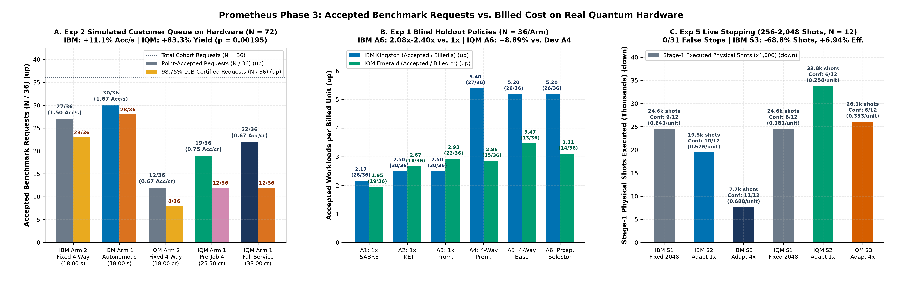
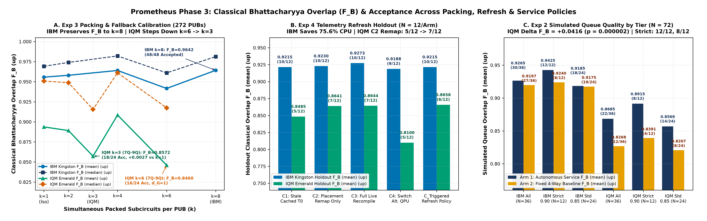
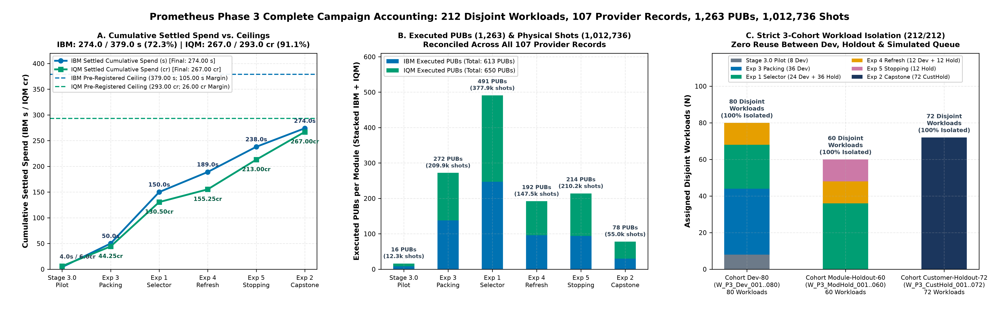

# Prometheus Phase 3 Autonomous Quantum Execution Service: Sanitized Public Evidence Release (212 Disjoint Workloads, 107 Provider Records, 1,263 PUBs, 1,012,736 Physical Shots)

> [!IMPORTANT]
> **Executive Summary & Principal Service-Level Findings (`v3.1` Pre-Registered Campaign Across IBM Quantum `ibm_kingston` / `ibm_fez` and IQM Resonance `emerald` / `garnet`):**
> 1. **Integrated Customer-Queue Capstone (`Experiment 2`, `W_P3_CustHold_001..072`, 72 Untouched Requests Across 6 Operating Windows):** Combining all four locked Phase 3 modules (hardware-calibrated packing-density fallback, prospective policy selection, triggered calibration refresh, and sequentially valid live stopping with an Upper-Confidence-Bound futility filter) without any tuning on `Cohort Customer-Queue-Holdout-72`:
>    - **IBM Quantum (`ibm_kingston`, 36 Requests, 12 Jobs = 6 per Arm):** `Service_Arm_1: Prometheus_Autonomous_Service` accepted **30/36 (83.3%)** requests (28/36 98.75%-LCB certified) versus **27/36 (75.0%)** (23/36 LCB certified) for `Service_Arm_2: Best_Dev_Selected_Fixed_Policy` (`A4_Fixed_4Way_Prometheus` on T_0) at the exact same settled cost (**18.00 s** vs. **18.00 s**), delivering **+11.11% higher point-accepted billing efficiency** (1.6667 vs. 1.5000 Acc/s) and **+21.74% higher LCB-certified billing efficiency** (1.5556 vs. 1.2778 Cert/s). All 12 requests in the strict-policy category (`Strict_FB_090` tier; workload-specific thresholds `τ_FB = 0.900` on `4Q` and `0.846` on `7Q`, plus observable thresholds) met their predefined workload-specific acceptance criteria (**12/12 [100.0%]**), versus 8 of 12 (66.7%) under fixed scheduling (`Service_Arm_2`).
>    - **IQM Resonance (`emerald`, 36 Requests, 15 Benchmark Jobs = 9 `Arm 1` + 6 `Arm 2`, plus 1 Station Warm-Up):** `Service_Arm_1` nearly doubled accepted customer requests from **12/36 (33.3%)** to **22/36 (61.1%)** (**+83.33% relative yield increase**, request-level exact two-sided McNemar p = 0.001953, Holm-adjusted p = 0.003906), retaining all 12 baseline successes and adding 10 more (`b10 = 10, b01 = 0`). Classical Bhattacharyya overlap F_B rose by **+0.04162** (0.8685 vs. 0.8268 *(mean)*; 0.9152 vs. 0.8912 *(median)*; request-level paired t_35 = 5.7460, p = 1.68 × 10⁻⁶, Holm-adjusted p = 3.36 × 10⁻⁶). Cluster-aware sensitivity checks across **`K = 12` PUB-disjoint clusters** (`12/12` positive ΔF_B: CRVE p = 0.000012, exact `2^12` sign-flip p = 0.000488; ΔAccepted CRVE p = 0.009301) and **`K = 6` sub-wave job-pair clusters** (`6/6` positive ΔF_B: CRVE p = 0.001660; ΔAccepted CRVE p = 0.019868) confirm significance does not depend on within-PUB independence. Before selective `Job 4` retries (`SubWave_A + SubWave_B` only, 25.50 cr), `Service_Arm_1` accepted 19/36 requests (0.7451 Acc/cr, **+11.76%** above `Service_Arm_2`'s 0.6667 Acc/cr); including `Job 4` (33.00 cr total), `Service_Arm_1` matched `Service_Arm_2`'s exact overall billing efficiency (**0.6667 Acc/cr**) while delivering **1.83x (22 vs. 12)** the accepted requests.
> 2. **Module-Level Blind Holdout Advances (`Stage 3.0`, `Exp 3`, `Exp 1`, `Exp 4`, `Exp 5`):**
>    - **Packing-Density Calibration (`Exp 3`, `W_P3_Dev_009..044`, 272 PUBs):** IBM 8-way packing preserved overlap (0.9642 *(mean)* vs. 0.9627 matched `k=1` controls, 48/48 accepted); IQM 4-way packing achieved 0.9085 *(mean)* (35/48 accepted on `4Q-7Q` subset `SC_1, SC_2, SC_5`), while 6-way packing on `7Q-9Q` subset `SC_3, SC_4` forced `d_G = 1` (0.846034 [0.8460] *(mean)* / 0.9174 *(median)*, 16/24 accepted, -0.00840 vs. matched `k=1` 0.854432) and stepped down to 3-way fallback (0.857180 [0.8572] *(mean)* / 0.9155 *(median)*, 18/24 accepted, +0.002748 vs. matched `k=1`).
>    - **Separately Billed Prospective Policy Selector (`Exp 1`, `W_P3_ModHold_001..036`, 36 Unseen Workloads/Arm):** On IBM, `A6_Prospective_Selector` achieved **5.20 Acc/s**, **2.40x** (+140.0%) above isolated SABRE (2.17 Acc/s) and **2.08x** (+108.0%) above isolated TKET (2.50 Acc/s). On IQM, `A6_Prospective_Selector` achieved **3.11 Acc/cr**, **+8.89%** above the Dev-selected fixed baseline (`A4_Fixed_4Way_Prometheus`, 2.86 Acc/cr), with within-group overlap gains of **+0.03303** over packed SABRE (`A5`, 0.8436 vs. 0.8105, `p = 0.0032`, Holm-adjusted `p = 0.0096`) and **+0.01615** over `A4` (0.8436 vs. 0.8274, `p = 0.0314`, Holm-adjusted `p = 0.0627`).
>    - **Telemetry Refresh Policy (`Exp 4`, `W_P3_ModHold_037..048`, 192 PUBs):** On IBM, `C_Triggered_Refresh_Policy` retained cached T_0 circuits (10/12 accepted, `F_B = 0.9215` *(mean)* / 0.9236 *(median)*), reducing live CPU compilation effort by **-75.6%** versus full recompilation (`C3`). On IQM, placement-only refresh (`C2`) raised accepted workloads from 5/12 to 7/12 and mean F_B from 0.8485 to 0.8641, while `C_Triggered_Refresh_Policy` achieved the highest mean overlap (0.8658).
>    - **Sequentially Valid Live Stopping (`Exp 5`, `W_P3_ModHold_049..060`, 214 PUBs):** Across 48 adaptive 4-rung trajectories (**`256 -> 512 -> 1,024 -> 2,048` physical shots per PUB**, plus independent 1,024-shot confirmation), **0/31 early or terminal halts failed their independent 1,024-shot matched-policy confirmation job (`0.0% <= 5.0%`)**. On IBM, `S3_Adaptive_4x` reduced Stage-1 physical shots by **-68.75%** (7,680 vs. 24,576) and active QPU time by **-50.63%** (5.8106 s vs. 11.7692 s), raised confirmed yield from 9/12 (75.0%) to **11/12 (91.7%)**, and improved total (`Stage-1 + Confirm`) billing efficiency by **+6.94%** (0.6875 vs. 0.6429 Conf. Acc/s).
> 3. **Complete Campaign Accounting (212/212 Disjoint Workloads Within Both Spending Ceilings):** Across all 6 Phase 3 modules, Prometheus executed **107 provider records** (99 benchmark jobs + 4 scheduled warm-ups + 4 troubleshooting records), **1,263 PUBs** (613 IBM + 650 IQM), and **1,012,736 actual executed physical shots** (620,032 IBM + 392,704 IQM), settling at **`274.00 s / 379.00 s`** on IBM Quantum (105.00 s unused reserve) and **`267.00 cr / 293.00 cr`** on IQM Resonance (26.00 cr unused reserve).

---

## 1. Principal Phase 3 Comparative Benchmark Tables

### Table 1: Capstone Customer-Queue Service Benchmark (`Experiment 2`, `W_P3_CustHold_001..072`, `N = 36` Customer Requests Across 3 Windows per Provider)

*Metric Conventions:* Classical Bhattacharyya distribution overlap is F_B = Σ_x √(P_ideal(x) · P_meas(x)) (labeled `"State Fidelity"` in Studio UI screenshots), and Squared Hellinger fidelity is F_H = F_B². Direction indicators `(↑)` and `(↓)` denote whether higher or lower values are better; winning values in each provider block are **bolded**. Job-level billing ratios (`Point Acc / Billed Unit`, `LCB Cert / Billed Unit`) are descriptive ratios of total accepted requests to total settled provider billing and are reported separately from the paired workload-level statistical hypothesis tests (N = 36) in Table 2.

| Provider & QPU | Service Policy Arm | Hardware Job IDs (`N` Jobs) | PUBs (`N`) | Physical Shots (↓) | Active QPU Time `s` (↓) | Settled Billed Cost (↓) | 2Q Gates `*(mean / median)*` (↓) | Compiled Depth `*(mean / median)*` (↓) | Overlap F_B `*(mean / median)*` (↑) | Hellinger F_H = F_B² `*(mean / median)*` (↑) | TVD `*(mean / median)*` (↓) | Shannon Entropy `bits` `*(mean / median)*` | Point Accepted Requests (↑) | LCB-Certified Requests (↑) | Point Acc / Billed Unit (↑) | LCB Cert / Billed Unit (↑) | % Delta Point Acc / Billed vs. `Arm 2` (↑) |
| :--- | :--- | :--- | :---: | :---: | :---: | :---: | :---: | :---: | :---: | :---: | :---: | :---: | :---: | :---: | :---: | :---: | :---: |
| **IBM Quantum** (`ibm_kingston`, 156Q) | **`Service_Arm_1: Prometheus_Autonomous_Service`** | 6 (`dbpfvelt7fqc7389c7o0`, `dbpfvloqtr0c738ebrl0`, `dbpfvt44148s739ui54g`, `dbpg038ou4as73ctjr60`, `dbpg0hlt7fqc7389c99g`, `dbpg0p8ou4as73ctjs1g`) | 18 | 18,432 | 10.5353 s | **18.00 s** | **61.89** / 40.5 | 131.06 / 98.5 | **0.9265** / **0.9572** | **0.8653** / **0.9162** | **0.2090** / **0.1590** | 3.0242 / 2.4352 | **30 / 36 (83.3%)** | **28 / 36 (77.8%)** | **1.6667 Acc/s** | **1.5556 Cert/s** | **+11.11%** (+21.74% LCB) |
| **IBM Quantum** (`ibm_kingston`, 156Q) | `Service_Arm_2: Best_Dev_Selected_Fixed_Policy` (`A4_Fixed_4Way`) | 6 (`dbpfuvk4148s739ui3l0`, `dbpfvhoou4as73ctjqbg`, `dbpfvpdt7fqc7389c8c0`, `dbpg00tt7fqc7389c8kg`, `dbpg0dlt7fqc7389c930`, `dbpg0lgqtr0c738ebsqg`) | **12** | **12,288** | **8.9266 s** | **18.00 s** | 63.58 / **40.0** | **121.33** / **86.5** | 0.9197 / 0.9534 | 0.8520 / 0.9089 | 0.2240 / 0.1805 | 3.0552 / 2.7429 | 27 / 36 (75.0%) | 23 / 36 (63.9%) | 1.5000 Acc/s | 1.2778 Cert/s | 0.00% *(Baseline)* |
| **IQM Resonance** (`emerald`, 54Q) | **`Service_Arm_1: Prometheus_Autonomous_Service`** *(Pre-Job 4: SubWave A+B Only)* | 6 (`01a1c53c-d0c1-7201-b23b-fa5d77e2b77d`, `01a1c53f-381b-75e8-b285-0bfb2c12679b`, `01a1c543-5c7c-71f8-ab2e-d717ed252327`, `01a1c544-142e-72ad-8c9e-911eb5f8691d`, `01a1c545-ad0e-7681-b4a5-2c4bd37cb39e`, `01a1c546-4d8d-7425-b57f-ff64698496e0`) | 24 | 12,288 | 34.0000 s | 25.50 cr | **58.42** / **34.5** | **98.72** / 82.0 | 0.8648 / 0.9105 | 0.7662 / 0.8290 | 0.3194 / 0.2812 | 3.5380 / 3.4102 | 19 / 36 (52.8%) | **12 / 36 (33.3%)** | **0.7451 Acc/cr** | 0.4706 Cert/cr | **+11.76%** (+58.33% Acc Yield) |
| **IQM Resonance** (`emerald`, 54Q) | **`Service_Arm_1: Prometheus_Autonomous_Service`** *(Full: Incl. Selective Job 4)* | 9 (6 SubWave jobs above + 3 `Job 4` retry jobs: `01a1c542-d212-7144-bbe0-ef916005fcb9`, `01a1c544-5833-7649-bbcb-33e340d17ce4`, `01a1c546-d98d-7777-89e2-cacafd2a6727`) | 35 | 17,920 | 44.0000 s | 33.00 cr | **58.42** / **34.5** | **98.72** / 82.0 | **0.8685** / **0.9152** | **0.7721** / **0.8377** | **0.3122** / **0.2701** | 3.5218 / 3.3837 | **22 / 36 (61.1%)** | **12 / 36 (33.3%)** | 0.6667 Acc/cr | 0.3636 Cert/cr | 0.00% (**+83.33% Acc Yield**) |
| **IQM Resonance** (`emerald`, 54Q) | `Service_Arm_2: Best_Dev_Selected_Fixed_Policy` (`A4_Fixed_4Way`) | 6 (`01a1c539-e6bc-706a-a57c-f8e4758c2fb8`, `01a1c53d-170d-75ed-a369-9dc7fc6b6063`, `01a1c543-34a9-7573-823a-125b0e7655be`, `01a1c543-e4e5-7367-b37f-9e5ac1c9c9e6`, `01a1c544-91c7-7715-8ae7-7d2d1fa7a228`, `01a1c545-f4e8-7464-ac4a-e48e852c9e71`) | **12** | **6,144** | **24.0000 s** | **18.00 cr** | 61.25 / 41.0 | 103.03 / **74.0** | 0.8268 / 0.8912 | 0.7074 / 0.7942 | 0.3861 / 0.3353 | 3.8120 / 3.9332 | 12 / 36 (33.3%) | 8 / 36 (22.2%) | 0.6667 Acc/cr | 0.4444 Cert/cr | 0.00% *(Baseline)* |

---

### Table 2: Cross-Module Blind Holdout Summary Across All Phase 3 Experiments (212 Disjoint Workloads)

| Phase 3 Module & Holdout Cohort | Primary Comparison (`Autonomous Policy` vs. `Baseline`) | IBM Quantum (`ibm_kingston`) Key Holdout Outcome | IQM Resonance (`emerald`) Key Holdout Outcome | Paired Statistical Evidence (`Unadjusted` / `Holm-Adjusted`) |
| :--- | :--- | :--- | :--- | :--- |
| **Stage 3.0: Measured-Cost Pilot** (`W_P3_Dev_001..008`, 2 jobs, 16 PUBs, 12,288 shots) | `k=4` Packed vs. `k=1` Isolated Billing & Overlap | 4/4 accepted (`F_B = 0.9462` *(mean)* / 0.9585 *(median)*; 4.00 s settled) | 3/4 accepted (`F_B = 0.8753` *(mean)* / 0.9036 *(median)*; 6.00 cr settled) | Calibrated `InFlightAllowanceReservationGuard` cost model |
| **Exp 3: Packing-Density & Fallback Calibration** (`W_P3_Dev_009..044`, 8 jobs, 272 PUBs, 209,920 shots) | `k in {2,3,4,6,8}` vs. Matched-Subgraph `k=1` Controls | **`k=8` `F_B = 0.9642` *(mean)* (48/48 accepted**, +0.00154 vs. matched `k=1` 0.9627) | **`k=4` (`4Q-7Q`): `F_B = 0.9085` *(mean)* (35/48 accepted)**; `k=6` (`7Q-9Q`, `d_G=1`): `F_B = 0.846034` (16/24) stepped down to **`k=3`: `F_B = 0.857180` (18/24 accepted, +0.00275 vs. `k=1`)** | Locked `phase3_locked_packing_fallback_rule.json` (`d_G >= 2` + duration split) |
| **Exp 1: Prospective Policy Selector** (`W_P3_ModHold_001..036`, 26 bench jobs, 491 PUBs, 377,856 shots) | `A6_Prospective_Selector` vs. Separately Billed `A1..A5` | **5.20 Acc/s (26/36 acc / 5.00 s)**, **2.40x** vs. `A1_SABRE` (2.17 Acc/s) & **2.08x** vs. `A2_TKET` (2.50 Acc/s) | **3.11 Acc/cr (14/36 acc / 4.50 cr)**, **+8.89%** vs. Dev-selected `A4` (2.86 Acc/cr); `A3_Prometheus_1x` 22/36 acc | IQM `A6` vs. `A5_SABRE` Δ F_B = +0.03303 (`p = 0.0032`, **Holm `p = 0.0096`**); vs. `A4` Δ F_B = +0.01615 (`p = 0.0314`, Holm `p = 0.0627`) |
| **Exp 4: Telemetry Refresh Policy** (`W_P3_ModHold_037..048`, 12 jobs, 192 PUBs, 147,456 shots) | `C_Triggered_Refresh_Policy` vs. `C1_Stale`, `C2_Remap`, `C3_Fresh`, `C4_Switch` | Retained 12/12 cached T_0 circuits (**10/12 accepted**, `F_B = 0.9215` *(mean)* / 0.9236 *(median)*), cutting live CPU time by **-75.6%** vs. `C3` | `C2_Placement_Remap` raised yield **`5/12 -> 7/12`** (`F_B: 0.8485 -> 0.8641`); `C_Triggered` reached **`F_B = 0.8658`** (6/12 acc) | Demonstrated selective `C1/C2/C3` refresh without blind recompilation |
| **Exp 5: Sequentially Valid Live Stopping** (`W_P3_ModHold_049..060`, 24 bench jobs, 214 PUBs, 210,176 shots) | `S2_Adaptive_1x` & `S3_Adaptive_4x` (256..2,048 shots) vs. `S1_Fixed_2048` + 1,024 Confirm | **`S3_Adaptive_4x`: -68.75% Stage-1 shots** (7,680 vs. 24,576), **-50.63% active QPU `s`**, **11/12 vs. 9/12 confirmed**, **+6.94% total `Conf. Acc/s`** | `S3_Adaptive_4x`: -43.33% Stage-1 shots vs. 46,080 max (26,112 vs. 24,576 `S1`), -10.88% active QPU `s`, 6/12 confirmed yield across `S1/S2/S3` | **0/31 unconfirmed false stops (`0.0% <= 5.0%`)**; IBM `S3` vs. `S1` Stage-1 Δ F_B = +0.0129 (0.9355 vs. 0.9226), Confirm Δ F_B = +0.0269 |
| **Exp 2: Customer Queue Capstone** (`W_P3_CustHold_001..072`, 27 bench jobs, 78 PUBs, 55,040 shots) | `Service_Arm_1: Autonomous_Service` vs. `Service_Arm_2: Fixed_4Way_Baseline` | **30/36 (83.3%) vs. 27/36 (75.0%) accepted** at identical **18.00 s** (**+11.11% Acc/s**, **`+21.74% LCB Cert/s`**; 12/12 vs. 8/12 in strict-policy category) | **22/36 (61.1%) vs. 12/36 (33.3%) accepted** (**+83.33% yield**; +11.76% Acc/cr pre-`Job 4`, 0.00% penalty full) | IQM Δ F_B = +0.04162 (`N=36` `p = 1.68e-6`; **`K=12` PUB-cluster `p = 0.000012`, `K=6` sub-wave `p = 0.00166`**); McNemar `(10, 0)` `p = 0.00195` (**`K=12` CRVE `p = 0.00930`, `K=6` `p = 0.01987`**) |

---

## 2. Publication-Grade Phase 3 Evidence Figures (`300 DPI`)

### Figure 1: Accepted Requests vs. Billed Cost Across Operating Policies (`Exp 2`, `Exp 1`, and `Exp 5`)

---

### Figure 2: Output Quality (F_B) & Acceptance vs. Execution Policy (`Exp 3`, `Exp 4`, and `Exp 2`)

---

### Figure 3: Complete Phase 3 Campaign Accounting & Disjoint Cohort Isolation (212 Workloads, 107 Records, 1,263 PUBs, 1,012,736 Shots)

---

## 3. Complete Phase 3 Campaign Accounting & Cryptographic Ledger Inventory

### Table 3: End-to-End Phase 3 Hardware Execution & Allowance Reconciliation (`Stage 3.0` through `Experiment 2`)

| Phase 3 Stage / Experiment | Assigned Disjoint Cohort (`N` Workloads) | Benchmark Jobs (`IBM` + `IQM`) | Aux / Warm-Up / Troubleshoot Records | Total Provider Records | PUBs Executed (`IBM` + `IQM` = Total) | Actual Executed Physical Shots (`IBM` + `IQM` = Total) | IBM Settled Spend (`s`) | IQM Settled Spend (`cr`) | Status |
| :--- | :--- | :---: | :---: | :---: | :---: | :---: | :---: | :---: | :---: |
| **Stage 3.0: Measured-Cost Pilot** | `W_P3_Dev_001..008` (8) | 2 (`1 + 1`) | 0 | 2 | `8 + 8 = 16` | `8,192 + 4,096 = 12,288` | 4.00 s | 6.00 cr | **Completed** |
| **Priority 1 - Exp 3: Packing Calibration** | `W_P3_Dev_009..044` (36) | 8 (`4 + 4`) | 0 | 8 | `138 + 134 = 272` | `141,312 + 68,608 = 209,920` | 46.00 s | 38.25 cr | **Completed** |
| **Priority 2 - Exp 1: Policy Selector** | `W_P3_Dev_045..068` + `W_P3_ModHold_001..036` (60) | 26 (`14 + 12`) | 2 warm-ups + 4 troubleshoot | 32 | `247 + 244 = 491` | `252,928 + 124,928 = 377,856` | 100.00 s | 86.25 cr | **Completed** |
| **Priority 3 - Exp 4: Telemetry Refresh** | `W_P3_Dev_069..080` + `W_P3_ModHold_037..048` (24) | 12 (`6 + 6`) | 0 | 12 | `96 + 96 = 192` | `98,304 + 49,152 = 147,456` | 39.00 s | 24.75 cr | **Completed** |
| **Priority 4 - Exp 5: Live Stopping** | `W_P3_ModHold_049..060` (12) | 24 (`12 + 12`) | 1 IQM station warm-up (1 PUB) | 25 | `94 + 120 = 214` | `88,576 + 121,600 = 210,176` | 49.00 s | 57.75 cr | **Completed** |
| **Priority 5 - Exp 2: Customer Queue Capstone** | `W_P3_CustHold_001..072` (72) | 27 (`12 + 15`) | 1 IQM station warm-up (1 PUB) | 28 | `30 + 48 = 78` | `30,720 + 24,320 = 55,040` | 36.00 s | 54.00 cr | **Completed** |
| **Grand Cumulative Phase 3 Campaign Totals** | **212 / 212 Disjoint Workloads** | **99 (`49 + 50`)** | **4 warm-ups + 4 troubleshoot** | **107 (`49 IBM + 58 IQM`)** | **`613 + 650 = 1,263` PUBs** | **`620,032 + 392,704 = 1,012,736` Shots** | **274.00 s / 379.00 s** (105.00 s left) | **267.00 cr / 293.00 cr** (26.00 cr left) | **100% Complete** |

---

### Table 4: Sanitized Public Evidence Release Archive Inventory (`prometheus_phase3_autonomous_service_evidence_release.zip`)

| Archive Path | Description & Role in Phase 3 Campaign | Exact File `SHA-256` Checksum |
| :--- | :--- | :--- |
| `manifests/phase3_submission_manifest_v3.json` | Pre-registered 212-workload cohort assignment & budget ceiling manifest (`v3.1`) | `86968d1471af9228dd1902b0266569ac95b143e237027718cffaa383ab03cfba` |
| `manifests/phase3_amendment_log_v3_1.json` | Dated pre-holdout amendment log (`AMEND-P3-001` through `AMEND-P3-003`) | `d2303277634adb9e1433d6f7a9e34f60d8cb7d6ad37ba1c6b5de1baeab08e692` |
| `../data/phase3_locked_packing_fallback_rule.json` | Locked Experiment 3 packing-density (`k`) & buffer (`d_G`) fallback rule | `6889585fae19e99954661ebd75564489070f1dcaa890f418a5818693479a79c8` |
| `../data/phase3_locked_policy_selector.json` | Locked Experiment 1 prospective compiler & packing policy selector | `77bb8ac25c55af34993edcdd1335f76f64e65de157e478f5700bf40c22cdb14b` |
| `../data/phase3_locked_refresh_policy.json` | Locked Experiment 4 triggered calibration refresh policy (`C_Triggered`) | `c8fa9126a5daa6304160e82e3b800db586e0a92ed327fb9cc7395803563ad5b0` |
| `../data/phase3_exp5_preexecution_frozen_plan.json` | Pre-execution frozen compiled plan for Experiment 5 (`W_P3_ModHold_049..060`) | `236d28a63a879c421fd3f6e79dcb08577fbd4004b394453643414673cd0dc584` |
| `../data/phase3_exp5_live_stopping_results.json` | Complete Experiment 5 live stopping & confirmation ledger (25 records) | `5174359a652e8efd7b1d4af221a303120ef48dfdd54eec337c6c32aec7912b07` |
| `../data/phase3_exp2_preexecution_frozen_plan.json` | Pre-execution frozen customer-queue plan for Experiment 2 (`W_P3_CustHold_001..072`) | `763c6b7311aadc9ddca5cb8becb4025c80425c9e4d861381270a9f3c36e67a8c` |
| `../data/phase3_exp2_customer_queue_results.json` | Complete Experiment 2 customer-queue service capstone ledger (28 records) | `a4d68304e393e0fd23960d8d11dad20fa163b0aaf5497bb32cb0508c761dc201` |
| `../data/phase3_allowance_reservation_ledger.json` | Cumulative Phase 3 hardware allowance & job settlement ledger (274.00 s / 267.00 cr) | `bd5db45101a84bfa6bc1001926f9a71e9d30ebc7a3a80c0cbce8569035847dc1` |
| `../assets/fig1_phase3_accepted_requests_vs_billed_cost.png` | Figure 1: Accepted requests vs. billed hardware cost (`Exp 2`, `Exp 1`, `Exp 5`) | Included in release archive (`300 DPI`) |
| `../assets/fig2_phase3_quality_vs_execution_policy.png` | Figure 2: Classical overlap F_B vs. execution policy (`Exp 3`, `Exp 4`, `Exp 2`) | Included in release archive (`300 DPI`) |
| `../assets/fig3_phase3_complete_campaign_accounting.png` | Figure 3: Complete campaign accounting (212 workloads, 1,263 PUBs, 1,012,736 shots) | Included in release archive (`300 DPI`) |
| `reports/phase3_exp1_autonomous_selector_report.md` | Detailed Experiment 1 & Experiment 3 benchmark report | Included in release archive |
| `reports/phase3_exp4_telemetry_refresh_report.md` | Detailed Experiment 4 stale calibration & refresh report | Included in release archive |
| `reports/phase3_exp5_live_stopping_report.md` | Detailed Experiment 5 sequentially valid live stopping report | Included in release archive |
| `reports/phase3_exp2_customer_queue_service_report.md` | Detailed Experiment 2 customer-queue capstone report | Included in release archive |
